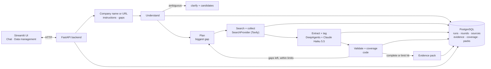

# VentureOS Research agent

> Version V.0.2 (`0.2.0`). Branch `agents/research`.

The Research agent is agent 1 of the VentureOS pipeline. Given a company name or website, it searches the web, keeps only relevant and verifiable evidence, tags it to the fields the GTM sub-agents need (company, market, competitors, sales), and stores every intermediate result in PostgreSQL. It gathers and organizes evidence; it does not analyze or write strategy.

## Input and output

**Input**

- A company name or website (required). `http://` is upgraded to `https://`, and the change is recorded.
- Optional instructions, for example `focus on mid-market` or `EU only`.
- Optional, on a re-run: a previous run ID and a list of gaps (for example `market.trends`), so only missing items are researched.

**Output: an evidence pack (schema v3)**

| Field | Checklist (checked in code) |
| --- | --- |
| Company | name, website, what they sell |
| Market | category, 1 or more size or growth signals, 2 or more trends |
| Competitors | 3 to 5 alternatives, each with website, positioning, and pricing (or `not_published`) |
| Sales | target customer, buyer role, pricing model, channel; buying signals optional |

- Every value is a list of evidence IDs. Each evidence item has a short statement, a verbatim excerpt, its source URL, the retrieval date, a `fact` or `inference` label, and 1 or more tags such as `competitors.pricing`.
- Coverage: for each field, `complete` or `partial`, with a list of what is missing.
- Run status: `complete`, `partial` (a limit was hit), `clarify` (the company name is ambiguous; candidates are returned), or `failed`.

The JSON Schema is in [src/research/pack.schema.json](src/research/pack.schema.json).

## Functionality

1. **Understand.** Normalize a given website and start research. With only a name, run 1 search and 1 model call to check the spelling (for example `Baseteen` becomes `Baseten`) and propose up to 5 official websites. The run stops with `clarify`; research starts after the user picks a website, and the typed spelling still counts as the company's name.
2. **Reason (ReAct, DeepAgents).** The research loop is a [DeepAgents](https://docs.langchain.com/oss/python/deepagents/overview) agent on Claude Haiku 5.5. The model decides what to search and read next, starting with the company's own site, then market, then competitors. It works only through 5 tools: `coverage_status`, `search_web`, `read_source`, `add_evidence`, and `note_gap`. Code validates every tool call; a search may target only the company's site, a known competitor's site, or a site already collected.
3. **Act: search and collect.** Each `search_web` call is 1 stored round. Keep at most 3 pages per search, preferring new sites. Skip duplicates (ignoring `www.`), non-public or non-HTTPS URLs, and low-value pages on any site (careers, benefits, legal, sign-in, PDFs). Reject pages about a different company (typed, confirmed, and domain names all count), except category market reports in market searches, which may support market items only. Competitor pages count only from the competitor's own site or a pricing, comparison, or review page about it. Caps: 3 general, 2 pricing, 2 customer, and 1 funding or launch page from the company site; 2 general pages plus 1 pricing page per other site; 5 competitors.
4. **Observe: read and record.** The model reads a source with `read_source` and records items with `add_evidence`; a rejected item comes back with the reason so it can fix it. Only direct competitors are recorded (the model labels each one direct or adjacent), and only from comparison, alternatives, review, or competitor pages. Competitors are rejected when the excerpt describes an acquisition, integration, or partnership, or when the competitor published the page. Competitor pricing must state a price; forum posts cannot supply competitor positioning or pricing. Competitors are ranked by how many sources name them, and details are required for the top 3.
5. **Check coverage.** Code, not the model, recomputes coverage and stores a snapshot.
6. **Repeat** until every field is complete or a limit is hit: 12 searches, 36 sources, 36 model calls. Hitting a limit returns a `partial` pack with its gap list, never an error. The Anthropic client retries rate limits and server errors with backoff.

Evidence rules enforced in code: excerpts are 25 to 400 characters and appear verbatim in their source; each excerpt supports 1 item (a list of competitors may support 1 item per competitor); names and numbers in a statement must appear in its excerpt; facts from forums become inferences; company offering and pricing model must cite the company's own site when one was collected. Page text is treated as untrusted data.

## Mini-architecture



The loop is a DeepAgents agent whose tools are backed by deterministic code, so the model can choose what to research but cannot write the pack directly. Search and model providers sit behind small interfaces, and storage sits behind a `Store` interface with PostgreSQL and in-memory implementations. A plain Python loop with the same checks remains as the fallback for models without a chat interface; the offline tests use it.

## Run

Requires Python 3.11+. Copy `.env.example` to `.env` (git-ignored) and set `ANTHROPIC_API_KEY` and `TAVILY_API_KEY`. `RESEARCH_MODEL` picks the model: the default is `claude-haiku-5-5`, Anthropic's lowest-cost current model; a `gemini-*` ID uses Gemini with `GEMINI_API_KEY`. `RESEARCH_DATABASE_URL` is optional; without it, runs are kept in memory until the backend stops.

```bash
python3 -m pip install -e '.[research,api,ui]'
```

Start the FastAPI backend, then the Streamlit UI in a second terminal:

```bash
PYTHONPATH=src python3 -m research.api
```

```bash
streamlit run UI/app.py
```

The UI only sends input and shows output; all processing runs in the backend. It has 2 views in the sidebar:

- **Chat:** send a company name or website. For a name, the agent checks the spelling and proposes websites (reply with a number, name, or website) or when the pack is partial (reply `yes` to research only the missing items). Packs are shown with coverage, cited evidence, and a JSON download.
- **Data management:** every stored run, with its evidence pack, each round's query and coverage, and kept and rejected sources.

The backend binds to `127.0.0.1` and has no authentication, so run it on your own machine. Chat sessions are in memory; runs and packs are in the store.

| Endpoint | Purpose |
| --- | --- |
| `POST /api/sessions` | Start a chat session |
| `POST /api/sessions/{id}/messages` | Send `{"message", "instructions"}`; returns a job ID |
| `GET /api/jobs/{id}?after=N` | Progress events and the reply |
| `GET /api/runs` | Stored runs, newest first |
| `GET /api/runs/{id}` | 1 run and its evidence pack |
| `GET /api/runs/{id}/rounds` | Rounds, coverage per round, and sources |

A CLI is also available: `PYTHONPATH=src python3 -m research "Basecamp" --website basecamp.com`.

`research.pack.gtm_gaps(pack)` lists what still blocks the GTM agents (at least 1 cited item per section and 3 described competitors; buying signals optional). A live smoke check researches real companies and scores each pack; it makes billed calls and is not part of the tests:

```bash
PYTHONPATH=src python3 scripts/live_smoke.py linear.app baseten.co vercel.com
```

Tests use provider doubles and never call live services; they cover the shared rules, storage, API, and the fallback loop, not the live DeepAgents loop, which the smoke check covers. Set `RESEARCH_TEST_DATABASE_URL` to a disposable database to run the PostgreSQL tests.

```bash
PYTHONPATH=src python3 -m unittest discover -s tests -v
```

## Status

- Implemented: input normalization, name check with website options, DeepAgents research loop on Claude Haiku 5.5, evidence checks, checklist coverage, re-runs from gaps, PostgreSQL and in-memory storage, FastAPI backend, Streamlit chat and data management UI, CLI.
- Planned: updated golden fixture, a model check that a statement follows from its excerpt, pgvector retrieval.
