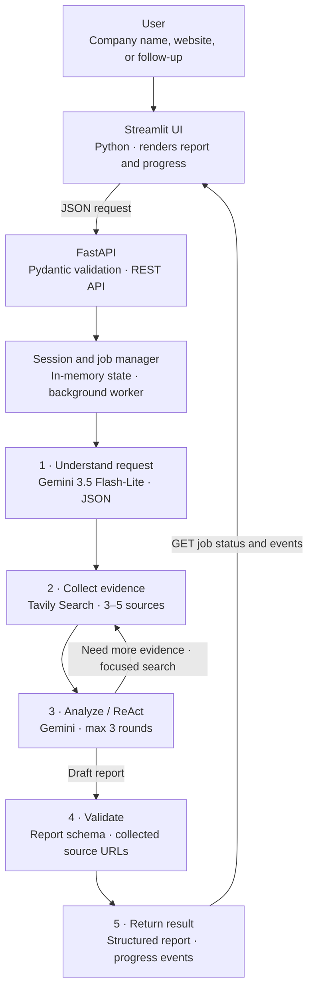

# VentureOS | Web Intelligence agent

This branch is scoped for **Web Intelligence** agent - a company-research agentic workflow.

The Streamlit app is a visualization client; the FastAPI backend owns request
understanding, web search, report generation and validation, session state, and
follow-up answers.

## Versioning

Current release: **V.0.1** (package version `0.1.0` in `pyproject.toml`).
Increment the version by `0.1` for every subsequent update published to GitHub:
the next published update is **V.0.2** (`0.2.0`). Keep this section, the
versioning rule in `AGENTS.md`, and the package version in sync.

## Architecture



Follow-up messages re-enter the same backend flow and are answered from the
accepted report and collected evidence.

## ReAct workflow

The backend runs one bounded research worker rather than several independent model-driven subagents. It classifies the request, collects 3 to 5 distinct sources, analyzes the evidence, and can request another focused search for up to 3 rounds. Every step emits input, output, and a success/failure status for the UI. The shared evidence set keeps follow-ups grounded in the same sources. Splitting this into separate agents is a future option only if the workflow needs independent permissions or parallel research.

Tavily supplies search results and extracted page text; the backend retains source URLs and retrieval timestamps. The report lists only URLs returned by search and collected by the worker.

The final report uses the golden-data shape: company, problem, market, ICP,
solution, positioning, and source URLs. [The golden fixture](tests/agents_data/web_intelligence_golden_data.json) is test reference data only; the app never uses it as a live response.

## Demo result

Example of the structured report shown in the UI. This is demo content, not a
guarantee of a live research result:

```Markdown
**Company:** [Vercel](https://www.vercel.com/) - Vercel is a cloud application platform and developer experience platform that provides developer tools, frameworks, and managed infrastructure to build, deploy, and scale web applications, websites, and AI agents.

**Value proposition:** Vercel is the platform where humans and AI agents build, ship, and scale software together.

**Problem:** Frontend developers and engineering teams face friction managing underlying server infrastructure, deploying applications at scale, integrating modern AI capabilities, and optimizing web performance across global edge networks.

- High complexity in setting up backend infrastructure and continuous delivery pipelines
- Managing deployments and scaling applications across multi-tenant environments
- Integrating conversational streaming and modern AI features into web workflows

**Market:** Software Development | Cloud Platform as a Service (PaaS) / Frontend Cloud

**Business model:** B2B SaaS / Tiered subscription pricing for developer tools and cloud hosting infrastructure

**Target client:** Technology companies, digital agencies, and engineering teams building modern web applications

**Target ICP buyer:** Chief Technology Officers, Engineering Managers, and Lead Developers

**End users:** Frontend developers, Full-stack software engineers, AI agents and engineering teams

**Solution:** Vercel Developer Experience Platform, Next.js, v0, and AI SDK - Provides a comprehensive frontend cloud and autonomous stack supporting Git-based deployments, global edge content delivery networks, automated CI/CD, and specialized AI development tools.

**Sources:**

- [https://en.wikipedia.org/wiki/Vercel](https://en.wikipedia.org/wiki/Vercel)
- [https://tavily.com/knowledge/company/zLugO9jdLlPE](https://tavily.com/knowledge/company/zLugO9jdLlPE)
- [https://www.linkedin.com/company/vercel](https://www.linkedin.com/company/vercel)
- [https://vercel.com/legal/privacy-notice](https://vercel.com/legal/privacy-notice)
```

## Run locally

Python 3.10+ is required. Install the branch's API and UI dependencies:

```bash
python3 -m venv .venv
.venv/bin/python -m pip install -e '.[chat,ui,test]'
```

Configure a Tavily key and Gemini API key in the shell or root `.env`. The
default model is Gemini 3.5 Flash-Lite (`gemini-3.5-flash-lite`), the current
stable Flash-Lite API model. Google lists it separately from Gemini 3.8 Flash;
there is no Gemini 3.8 Flash-Lite text model in its current model catalog.
Availability and free quotas depend on the Google AI Studio project and account.

```bash
export TAVILY_API_KEY="..."
export GEMINI_API_KEY="..."
export GEMINI_MODEL="gemini-3.5-flash-lite"
PYTHONPATH=src .venv/bin/python -m web_intelligence.api
```

In another terminal:

```bash
PYTHONPATH=src .venv/bin/streamlit run UI/app.py --server.address 127.0.0.1
```

The API and UI bind to loopback by default. Sessions are held in process memory
and disappear on restart. This prototype has no authentication and is not
suitable for public deployment. Do not expose it to an untrusted network.

## Local API

- `POST /api/sessions` creates an in-memory conversation.
- `POST /api/sessions/{session_id}/messages` accepts `{"message":"Stripe"}` and
  returns a job ID.
- `GET /api/jobs/{job_id}?after=0` returns progress events and the final result.
  Each event includes `module`, `input`, `output`, and `status`.
- `GET /api/sessions/{session_id}` returns conversation history.

The backend is also available as `web-intelligence-api` after installation.

## Verify

Tests use provider doubles and the golden file; they do not call live services:

```bash
PYTHONPATH=src .venv/bin/python -m unittest discover -s tests -p 'test_web_intelligence.py' -v
```
