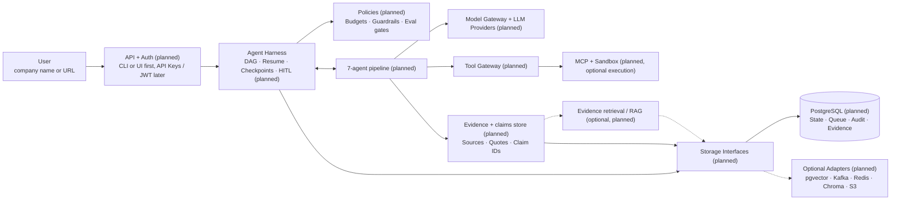
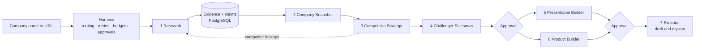

# VentureOS

### From a company name or URL to market positioning, a GTM and sales strategy, and a working mini-MVP.

VentureOS is a business operations harness that is designed to coordinate 7 specialized AI agents (planned) to analyze a company and the market it operates in, assess its strengths and weaknesses in market positioning, identify the clients it targets, build a GTM and sales strategy for them, and produce a simple mini-MVP of a similar solution.

Built for small B2B agencies and technical consultancies connecting research, sales preparation, and delivery across disconnected tools.

> **Status: shared runtime foundations.** The credential-free preview remains dependency-free. Optional PostgreSQL execution adds task leases, checkpoints, approvals, budget reservations, validation, audit, and tracing interfaces. The Research agent (agent 1) runs standalone with a local API and viewer and is not connected to the harness yet; see [docs/research.md](docs/research.md). The other 6 business agents, live integrations, and full production controls remain planned. See [Current State](docs/agents_todo.md#current-state).

## Architecture

**Postgres only by default, scale with optional adapters (planned).** Local disk holds files. The default command is a credential-free preview. Shared runtime foundations are available separately; the diagrams below show the target architecture, with remaining components labeled planned.

### Runtime



Cross-cutting: OpenTelemetry tracing · Offline eval harness as a CI release gate (planned)

### Agent pipeline

The harness is deterministic code, not an LLM agent. It runs the 7 agents as a pipeline, applies eval gates between stages, and pauses for human approval before anything leaves the system.



Pipeline rules (planned):

- Research is a reusable tool: it runs for the target company and again for each competitor requested by Competitive Strategy.
- Downstream agents cite claim IDs from the evidence store. Anything without a citation is labeled a hypothesis.
- An eval gate checks each stage output before the next stage starts.
- Presentation Builder and Product Builder run in parallel after the first approval.
- Product Builder writes a spec first, builds from a fixed scaffold in a sandbox, and records a demo GIF. It solves the same job as the target product and does not copy it.
- Executor drafts and dry-runs email, CRM, and onboarding steps. Real sends require approval.

Architecture details:

- [Storage defaults and interfaces](docs/architecture/storage.md)
- [Optional adapters](docs/architecture/adapters.md)
- [Safety and runtime policies](docs/architecture/safety.md)

## 7 agents. 1 harness.

Agent execution and deliverables below are (planned); role specifications and a fixed workflow preview exist today.

| # | Agent | Responsibility | Deliverable |
| --- | --- | --- | --- |
| 1 | Research (Web Intelligence) | Collect information about the company, its industry, and trends from a name or URL; also researches competitors on request | Sourced evidence and claims |
| 2 | Company Snapshot | Turn evidence into a structured company profile: offer, customers, pricing, signals | Company summary with claim IDs |
| 3 | Competitive Strategy | Compare alternatives, pricing, positioning, and gaps; assess strengths and weaknesses | Positioning analysis and ranked opportunity hypotheses |
| 4 | Challenger Salesman | Define the ICP, commercial insight, GTM and sales strategy, and tailored outreach | ICP, offer, and outreach drafts |
| 5 | Presentation Builder | Package the approved offer and unique value proposition | Concise proposal |
| 6 | Product Builder | Build a scoped mini-MVP of a similar solution | Architecture, tested prototype, demo GIF |
| 7 | Executor (Workflow Automation) | Execute approved email, CRM, onboarding, and delivery steps and track work to completion | Action records and outcome data |

Contracts exist for all 7 roles. Only Research is implemented, as a standalone agent that is not connected to the harness. The preview harness returns a fixed workflow plan that still lists the earlier 6-agent set. The separate RuntimeHarness executes trusted registered plugins with PostgreSQL state, permissions, runtime validation, bounded retries, tracing interfaces, and task approval. Dynamic business-agent routing remains (planned).

## Quick start

Requires Python 3.10+. No dependencies or API keys are needed for the preview.

Run from the repository root:

```bash
PYTHONPATH=src python3 -m ventureos --brief examples/agency-brief.json
```

This prints a JSON workflow plan showing agent assignments, review checkpoints, and expected deliverables. It does not call models, browse the web, send email, or build a product.

## Project structure

```text
agents/                  7 agent instruction and output contracts
src/ventureos/
  agents.py              Agent registry
  contracts.py           Shared brief and workflow types
  harness.py             Workflow preview and execution boundary
  __main__.py            Local preview command
  research/              Research agent: engine, providers, local API, renderer
integrations/            Future model, research, email, and CRM adapters
docs/architecture.md     Execution model and acceptance criteria
docs/architecture/       Storage, adapters, and safety (planned)
examples/agency-brief.json
UI/app.py                Streamlit page for the Research agent
docs/research.md         Research agent usage, claim schema, and limits
```

## Roadmap

- [x] Define 6 agent roles and workflow contracts
- [x] Add a local workflow preview
- [ ] Connect a model provider and sourced research tools
- [x] Implement shared task state, runtime validation, budget reservations, and lease recovery
- [x] Implement hash-bound task approval gates
- [ ] Implement customer-feedback branching
- [x] Define the Company Snapshot contract and the evidence and claims schema
- [x] Build the standalone Research agent with cited claims, verbatim quote checks, and a local API and viewer
- [ ] Connect the Research agent to the harness runtime and model gateway
- [ ] Add category-driven searches and an entailment check to Research
- [ ] Persist the evidence and claims store in PostgreSQL
- [ ] Add eval gates between pipeline stages
- [ ] Ship a thin end-to-end slice for 1 company across all 7 agents
- [ ] Run the Executor in draft and dry-run mode with mock adapters
- [ ] Add email and CRM adapters with duplicate-action prevention
- [ ] Publish a reproducible end-to-end example with cost and outcome data

## Contributing

Start with one workflow, agent contract, or adapter. Include a sample input, expected output, and a way to verify the result. Keep generated claims separate from sourced facts and observed customer outcomes.

## Inspiration

README organization and architecture references: [MetaGPT](https://github.com/FoundationAgents/MetaGPT), [CrewAI](https://github.com/crewAIInc/crewAI), [AutoGen](https://github.com/microsoft/autogen) (historical reference), [LangGraph](https://github.com/langchain-ai/langgraph), and [Agency Swarm](https://github.com/VRSEN/agency-swarm). These are references, not dependencies or affiliations.

## Optional shared runtime

Install the optional dependencies in a virtual environment:

```bash
python3 -m pip install -e '.[runtime,test]'
```

Set `VENTUREOS_DATABASE_URL` to a PostgreSQL database dedicated to VentureOS, then run:

```bash
PYTHONPATH=src python3 -m ventureos --brief examples/agency-brief.json --execute-demo --tenant demo --run-id brief-1
```

This initializes the shared tables and executes a local brief demo, not the business agents. Repeating the same ID and input reuses the stored result. CLI tenant selection is operator-only, not authentication. See [testing instructions](tests/README.md) and [runtime limits](docs/agents_todo.md#current-state).
