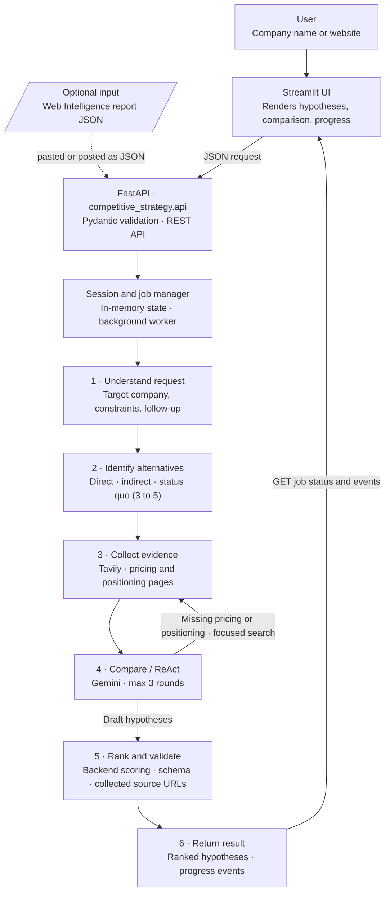

# VentureOS | Competitive Strategy agent

This branch is scoped for the **Competitive Strategy** agent: it compares
alternatives, pricing, positioning, and gaps, and returns **ranked opportunity
hypotheses**.

> **Status: planned.** This README and `AGENTS.md` define the target design.
> The Competitive Strategy backend, UI, and tests are not implemented yet.

Competitive Strategy is a **separate, self-contained module**
(`src/competitive_strategy/`) with its own API, providers, UI, and tests. It
does not import or call Web Intelligence. It can optionally accept a Web
Intelligence report as JSON input, but it works from a company name or website
alone.

The Streamlit app is a visualization client; the FastAPI backend owns request
understanding, alternative discovery, evidence collection, comparison,
hypothesis ranking and validation, session state, and follow-up answers.

## Versioning

No release yet. The first implemented release will be **V.0.1** (package
version `0.1.0` in `pyproject.toml`). After that, increment the version by `0.1`
for every update published to GitHub. Keep this section, the versioning rule in
`AGENTS.md`, and the package version in sync.

## Architecture



Follow-up messages re-enter the same backend flow and are answered from the
accepted assessment and collected evidence.

### Module layout (planned)

```text
src/competitive_strategy/
  contracts.py   Input, assessment, and provider interfaces
  providers.py   Search and model adapters (own copies, no cross-module imports)
  engine.py      Bounded ReAct worker: understand → alternatives → evidence → compare → rank
  scoring.py     Deterministic hypothesis scoring and ranking
  api.py         FastAPI app, sessions, jobs, progress events
UI/competitive_strategy_app.py   Streamlit client
tests/test_competitive_strategy.py
tests/agents_data/competitive_strategy_golden_data.json
```

The module runs on its own port and has its own install extra and CI job, so
it can be developed, tested, and released independently of other agents.

## ReAct workflow

The backend runs 1 bounded research worker:

1. **Understand.** Read a company name or website, plus optional constraints
   such as a target segment or price band. If a Web Intelligence report JSON is
   supplied, validate it and use it as context; otherwise research the target
   directly. Ask for clarification when the target is ambiguous.
2. **Identify alternatives.** Pick 3 to 5 alternatives a buyer would actually
   consider: direct competitors, indirect substitutes, and the status quo
   (for example, spreadsheets or an in-house build).
3. **Collect evidence.** Search for each alternative's pricing and positioning,
   keeping 1 shared source set of at most 15 sources with URLs and retrieval
   timestamps.
4. **Compare.** Build a like-for-like comparison of pricing, positioning, target
   segment, and strengths and weaknesses. If evidence is missing, request a
   focused search. Limit the loop to 3 rounds.
5. **Rank and validate.** The model proposes hypotheses with sub-scores; the
   backend computes the rank, checks the output shape, and rejects any source
   URL that was not collected.

Every step emits input, output, and a success or failure status for the UI.

## Output: ranked opportunity hypotheses

Each assessment contains the alternatives compared and 3 to 5 ranked
hypotheses:

| Field | Meaning |
| --- | --- |
| `rank`, `score` | Computed by the backend from the sub-scores below, not by the model |
| `hypothesis` | A testable claim about an underserved need or positioning gap |
| `target_segment` | Who the opportunity is for |
| `gap` | What the alternatives do not cover, or cover poorly |
| `sub_scores` | `pain`, `gap_size`, `competitor_weakness`, `fit` (1 to 5 each) |
| `evidence` | Collected source URLs that support the hypothesis |
| `disconfirming_evidence` | What argues against it, or what is unknown |
| `validation_question` | What must be confirmed with customers before acting |

Pricing is recorded per alternative with its model, price points, source URL,
and retrieval date. Unpublished pricing is reported as unknown, never estimated.

Illustrative shape only, not a live result:

| Rank | Hypothesis | Gap | Validate by asking |
| --- | --- | --- | --- |
| 1 | Mid-market SaaS teams want usage-based billing without a dedicated billing engineer | Alternatives need custom integration work or enterprise contracts | Who owns billing changes today, and how long does a pricing change take? |
| 2 | ... | ... | ... |

## Run locally

Not available yet. Planned: install with `pip install -e '.[strategy,ui]'`, run
`competitive-strategy-api` (FastAPI on `127.0.0.1:8001`) and the Streamlit UI on
loopback, configured with `TAVILY_API_KEY` and `GEMINI_API_KEY`. Sessions are
in memory and there is no authentication. Do not expose it to an untrusted
network.

## Verify

Planned: offline `unittest` tests with provider doubles and a golden reference
file, run in CI with no live web or model calls.
