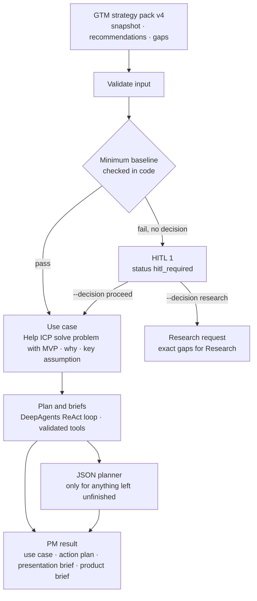

# VentureOS | PM agent

> Version **V.0.1** (`0.1.0`). Branch `agents/pm`: a separate, self-contained branch with
> only the PM agent. Each update published to GitHub increments the version by 0.1.

The PM agent is agent 3 of the VentureOS pipeline. **Its purpose is to establish 1 use case
before anything is built:**

> **Help {ICP} solve {core problem} with {MVP solution}.**

It reads the GTM orchestrator's strategy pack, checks that it meets a minimum baseline, asks a
human what to do when it does not (HITL 1), then picks the single most promising use case,
explains why in 1 to 3 sentences, and names the key assumption to test. The action plan and
the briefs for the Presentation builder and the Product builder all derive from that use
case, so the proposal pitches it and the demo builds it. It does not search the web and does
not import any other agent.

## Design remarks

- **1 use case, 1 source of truth.** GTM produces many recommendations; PM turns them into a
  decision. The builders work from the same use case, so the proposal and the demo cannot
  drift apart.
- **Structured, not just a sentence.** `icp`, `core_problem`, and `mvp_solution` are short
  phrases, each citing IDs from the pack; code builds the statement from them.
- **A sharper ICP than GTM's.** The ICP must name a role or team and its context; pricing
  tiers or plan names are rejected.
- **The core problem is a problem.** It must be a noun phrase ("scattered customer feedback
  that never becomes prioritized work"), not an action ("organize feedback").
- **An honest why.** 1 to 3 sentences naming the evidence, plus the key assumption that is
  not yet proven. At least 1 action must validate it.
- **Visible choice.** Up to 2 alternative use cases, each with why it was not picked.
- **Everything derives from the use case.** Code rejects actions and briefs until the use
  case is set; every action has a purpose: `validate`, `prepare`, or `deliver`.

## Input

- A GTM strategy pack (schema v4) as a JSON file: the company snapshot, the 3 sub-agents'
  recommendations (market analysis, ranked competitive hypotheses, challenger salesman),
  themes, and gaps.
- Optional: a HITL 1 decision (`proceed` or `research`) and instructions such as `EU only`.

## Flow



**Minimum baseline** (code, not the model):

| Check | Required |
| --- | --- |
| Research evidence pack is complete | yes |
| Snapshot has mission, problem, target market, ICP, product, client value, market brief, competition landscape | yes, each |
| Snapshot has vision | no (many companies publish none) |
| All 3 GTM sub-agents completed | yes |
| At least 2 ranked competitive hypotheses, 2 sales recommendations, 1 market recommendation | yes |

A failed snapshot line maps to the Research items that would fill it (for example a missing
mission maps to `company.mission`), so `--decision research` returns exactly what Research
should collect again.

**Planning.** The main planner is a [DeepAgents](https://docs.langchain.com/oss/python/deepagents/overview)
agent on Claude Haiku 5.5. It reads the pack through `read_strategy`, sets the use case
through `set_use_case`, then records its output through `add_action`,
`set_presentation_brief`, and `set_product_brief`; `plan_status` shows what is missing. Code validates every call: cited IDs must exist in the pack (for example
`r6` or `e3`), owners, priorities, horizons, counts, and lengths are checked, and a rejected
call returns the reason so the agent can fix it. Anything still missing after the agent
stops is filled by 1 JSON model call through the same validators, with 1 retry.

## Output

A PM result JSON (schema v1):

- `status`: `complete`, `partial` (planned after `proceed` with gaps, or something still
  missing), `hitl_required`, or `research_requested`.
- `baseline`: every check with pass or fail, the missing checks, and the Research gaps.
- `hitl` or `research_request` when the baseline fails.
- `use_case`: `icp`, `core_problem`, and `mvp_solution` (each with `text` and `based_on`),
  the built `statement`, `why` (1 to 3 sentences) with `why_based_on`, `key_assumption`, and
  up to 2 `alternatives` with `why_not`.
- `action_plan`: 3 to 7 actions serving the use case, each with a purpose (`validate`,
  `prepare`, `deliver`; at least 1 `validate`), owner (`sales`, `marketing`, `product`,
  `leadership`, `research`), priority 1 to 3, horizon (`now`, `next`, `later`), a success
  metric, and the IDs it is based on.
- `presentation_brief` for the Presentation builder (a 1-page proposal that pitches the use
  case): headline, problem,
  value proposition, target customer, 3 to 5 key points, proof points, call to action.
- `product_brief` for the Product builder (a demo of the MVP solution, not a copy):
  product goal, target user, core job, 3 to 5 must-have features, out of scope, success
  criteria, demo scenario.
- `planner`: which planner ran (`deepagents`, `json`, or both) and any rejected calls.

## Run locally

Python 3.11+. Install and set `ANTHROPIC_API_KEY` in `.env` (see `.env.example`):

```bash
python3 -m pip install -e '.[pm,test]'
```

Plan from a GTM strategy pack (billed model calls):

```bash
PYTHONPATH=src python3 -m pm data/notion-gtm.json
```

Try HITL 1 with the incomplete sample (no model calls until you choose `proceed`):

```bash
PYTHONPATH=src python3 -m pm data/notion-gtm-incomplete.json
PYTHONPATH=src python3 -m pm data/notion-gtm-incomplete.json --decision research
PYTHONPATH=src python3 -m pm data/notion-gtm-incomplete.json --decision proceed
```

Results go to `runs/<input name>-pm.json` (or `--output`). `--no-deepagents` uses only the
JSON planner. Exit codes: 0 complete or partial, 3 HITL 1 needed, 4 research requested,
2 invalid input.

## Samples

- `data/notion-gtm.json`, `data/linear-gtm.json`: real GTM strategy packs from live runs.
- `data/notion-gtm-incomplete.json`: the Notion pack with the mission and competition
  landscape removed and Research marked partial, to exercise HITL 1.

## Tests

Offline tests use provider doubles and a scripted stand-in for DeepAgents that calls the
same tools; they never call a live model:

```bash
PYTHONPATH=src python3 -m unittest discover -s tests -v
```

## Status

- Implemented: input validation, the minimum baseline, HITL 1 (`hitl_required`,
  `research`, `proceed`), the use case with code checks, the DeepAgents planner with
  validated tools, the JSON fallback planner, the CLI, and 21 offline tests.
- Live end-to-end check (PM only, real GTM output), both `complete` with DeepAgents alone:
  - Linear: "Help product and support teams whose work starts with customer conversations
    and feedback solve customer feedback that never reaches the right team as prioritized
    work with a feedback-to-issue routing tool." 6 actions (3 validate, 2 prepare, 1
    deliver); 2 alternatives rejected with reasons (multi-team planning lacks feature
    evidence; the free-tier motion is a GTM test, not a product MVP).
  - Notion: "Help small teams and early-stage companies that are just starting to work
    together on shared projects solve team knowledge and projects spread out instead of
    living in one shared place with a single shared workspace that combines team knowledge
    pages with a project tracker." 5 actions; the price-gap hypothesis was rejected as an
    MVP for resting on third-party prices.
- Planned: an API and UI step, and merging into `dev` as the pipeline step after GTM.
- Known limits: the use case can only be as good as GTM's evidence (Notion's ICP still rests
  on its Plus-plan description); statements can run long; whether a cited ID actually
  supports a sentence is not checked in code.
