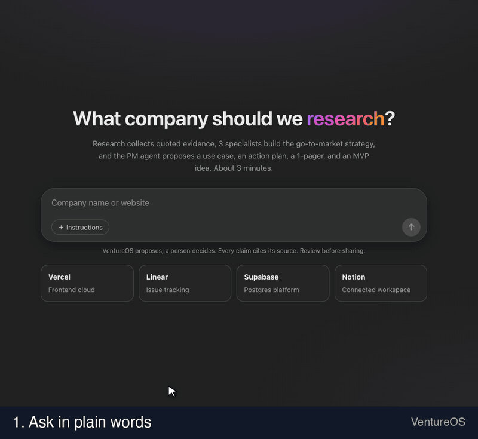
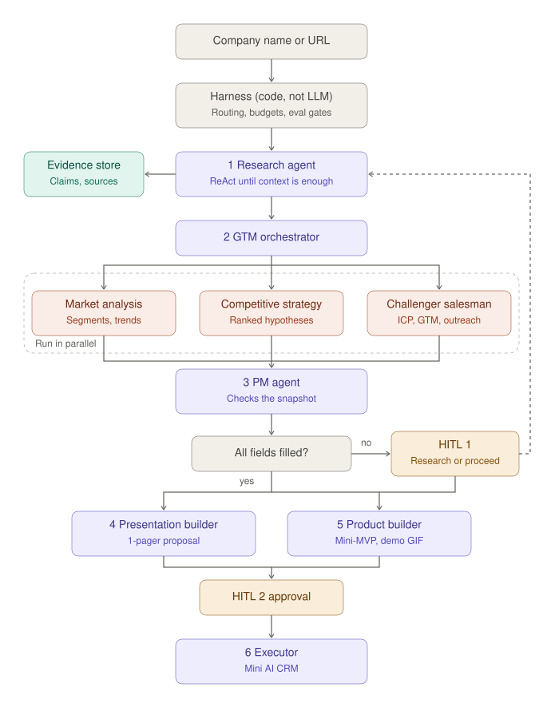
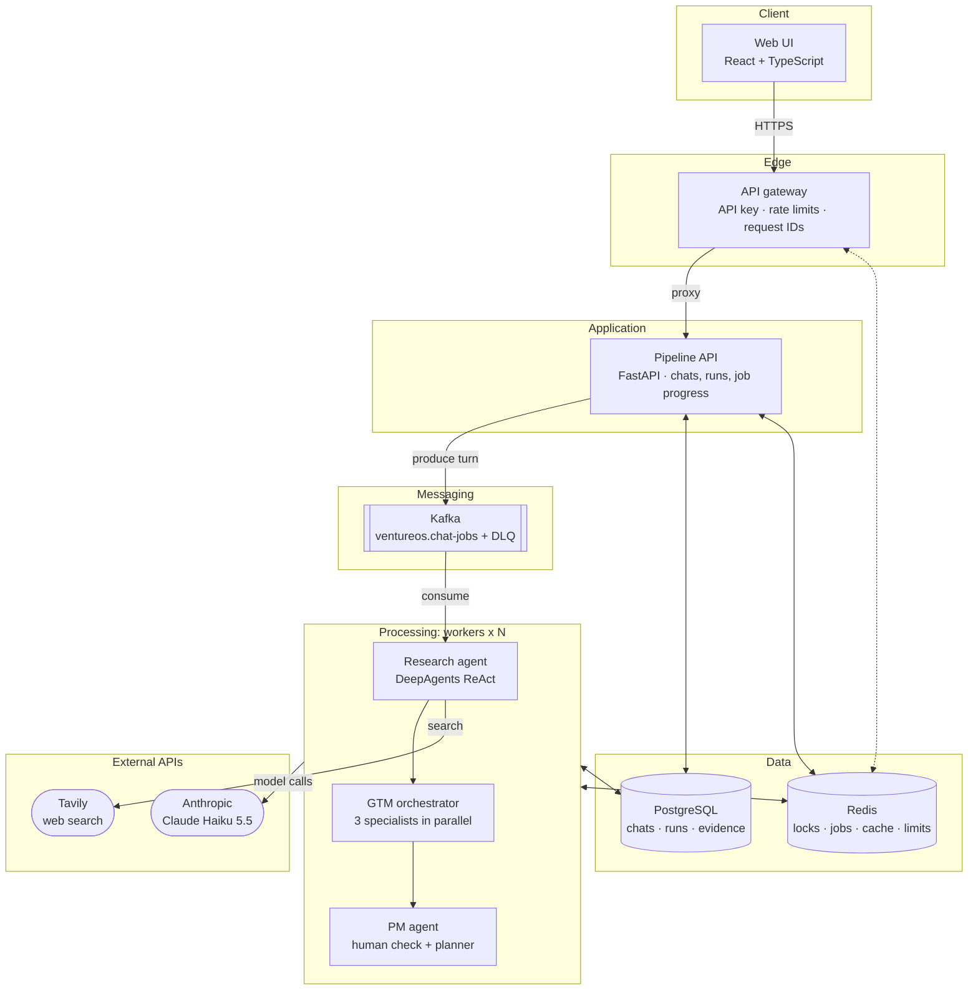

# VentureOS

[](https://github.com/efolley/Venture-OS/actions/workflows/tests.yml)
[](LICENSE)
[](pyproject.toml)

_Currently in development. Next step: a fully actionable harness and loop._

> **Still spending hours researching a prospect before the first call?**
>
> Just type a company name and let a swarm of agents do the work for you: GTM strategy, use case to pitch with a 1-pager, and an MVP idea to build.

<p align="center">
  
</p>
<p align="center"><sub>A real run on PostHog, about 3 minutes, sped up to 15 seconds.</sub></p>

VentureOS is a small team of agents that help you research the company and re-engineer its GTM and product. You have researcher + GTM + challenger salesman + PM - **All-In-One**.

## Overview

**The problem:** Before a first call with a prospect, we need to deep research the company - its market, its competitors, who it sells to, and where it is weak. We spent days to gather and synthesize information and can miss important data, causing generic pitches, messages, or even not the right target persona (ICP)

**The solution:** Run swarm of agents (and sub-agents) to research the company, it’s market positioning and competitive landscape, GTM, and even product: 3 min and you have a full GTM strategy 1-pager and idea for MVP.

## Example

**Input:**

```bash
ventureos-pipeline Baseten --website baseten.co
```

**Output** (about ~2 min; [full report](examples/baseten.md)):

> **Use case:** Help ML teams at AI-native startups solve slow, fragile prototype-to-production launches that break under real traffic, with a pre-launch production readiness check for model endpoints.
>
> **Key assumption (to test):** these teams see launch delay as a top blocker they would pay to fix. *Not yet proven.*
>
> **Action plan:**
>
> 1. Validate: interview teams on prototype-to-production blockers.
> 2. Validate: test the ideal customer against the 2-tier sales motion.
> 3. Validate: test the readiness-check concept with prospects.
> 4. Prepare: draft the readiness pitch.
> 5. Deliver: build a minimal check for 1 endpoint, only if validation says go.
>
> **1-pager:** "Get models from prototype to production without the weeks-long fragile launch." It has 5 key points and 4 proof points, each citing its source (e1, e2, e7, e8). The call to action is a 30-minute interview.
>
> **MVP idea:** endpoint intake, a launch-style traffic test, a failure report, and a pass/fail summary. Pricing, training, and support for other providers are out of scope.

Behind that output sit 25 sourced facts, 16 recommendations from the 3 specialists, and a cited company snapshot. Results vary from run to run, so review each one before you share it.

**Examples:** full reports for [Vercel](examples/vercel.md), [Linear](examples/linear.md), and [Baseten](examples/baseten.md). For a step-by-step tour of a run, see the [walkthrough](docs/walkthrough.md).

## Architecture

*Full technical architecture [below](#technology)*

<p align="center">
  
</p>

A simple script (the "pipeline") runs 3 agents, one after another:

1. **Researcher.** Searches the web and reads the company's site, its market, and its competitors. It keeps only facts it can quote word for word from a real page. It stops when it has enough, or when it runs out of budget.
   *You get:* an evidence pack, which is a list of sourced facts.
2. **GTM orchestrator.** Gives the evidence to 3 specialists who work in parallel, like a small consulting team:

   - **Market analyst:** how big the market is, where it is heading, and which segments to focus on.
   - **Competitive strategist:** how the company compares with alternatives, and which gaps are worth going after. Code scores and ranks the gaps.
   - **Challenger salesperson:** who the ideal customer is, what fresh insight to lead with, and how to reach them.

   It then merges their advice and writes a 1-page company snapshot covering mission, problem, customers, product, market, and competition.
   *You get:* a strategy pack.
3. **PM agent.** First it checks that the strategy covers the basics, such as mission, customers, and competitors. If something is missing, it **stops and asks you** whether to research more or carry on with the gaps marked unknown. Then it picks 1 use case, written as *"Help {customer} solve {problem} with {MVP}"*, and proposes:

   - **An action plan:** 3 to 7 next steps. At least 1 step tests the riskiest assumption.
   - **A 1-pager:** a short proposal you can read, edit, and send.
   - **An MVP idea:** what to build and for whom, the must-have features, and what is out of scope. It describes the MVP but does not build it.

   *You get:* a plan for a person to review and act on.

### Technology

**VentureOS is a multi-agent system:** UI talks through an API gateway to a FastAPI backend, which queues each chat turn in Kafka for workers that run 3 Claude agents, with PostgreSQL for saved chats and research and Redis for short-term state:

- **Web UI:** a React and TypeScript chat (Vite) that shows the saved transcript and does no processing.
- **API gateway:** `ventureos-gateway` (FastAPI and httpx) checks an optional API key, applies rate limits per client, and tags every request with an ID.
- **Pipeline API:** `ventureos-api` (FastAPI) serves the UI and the chat, run, and job-progress endpoints.
- **Job queue:** Kafka holds each chat turn, keyed by chat so turns stay in order, with a dead-letter topic for bad messages.
- **Workers:** `ventureos-worker` runs each turn (Research, then GTM, then PM), and you add workers to run more chats at once.
- **Research agent:** a DeepAgents ReAct loop on Claude Haiku 5.5 that searches the live web with Tavily and keeps only word-for-word quotes (retrieval without a vector store).
- **GTM orchestrator:** 3 specialist sub-agents run in parallel, then a merge step and a cited company snapshot, with hypotheses ranked by code.
- **PM agent:** a baseline check in code and a human check, then a DeepAgents planner whose every tool call code validates.
- **PostgreSQL:** stores saved chats with their transcripts, and every Research run, source, and evidence item.
- **Redis:** holds chat locks, job progress, a cache of open chats, and rate-limit counters, all expiring within 24 hours.
- **Optional infrastructure:** without PostgreSQL, Redis, or Kafka, VentureOS falls back to memory and runs everything in 1 process.



See [Tokenomics, evals, and observability](#details-for-developers) in the developer details. The [technical architecture](docs/architecture/technical-architecture.md) covers the data, failure handling, security, scaling, and a production-readiness scorecard.

### Why you can trust the output

- **Sourced.** Every fact cites the page it came from, and links that the search never returned are rejected.
- **Honest labels.** Advice is labeled `evidence_based` only when a source directly supports it. Everything else is labeled a `hypothesis`.
- **Code decides.** The AI proposes, then code checks limits, citations, scores, and rankings before anything is accepted.
- **No crashes on failure.** If a step runs out of budget or a specialist fails, you still get a usable result marked `partial`.

## Status

| # | Agent                                                            | Status  | Version |
| - | ---------------------------------------------------------------- | ------- | ------- |
| 1 | Researcher                                                       | Working | V.0.4   |
| 2 | GTM orchestrator (3 specialists and snapshot)                    | Working | V.0.4   |
| 3 | PM agent (human check, plan, 1-pager, MVP idea)                  | Working | V.0.2   |
|   | Pipeline (runs all 3 in 1 command, saved chats, Markdown report) | Working | V.0.4   |
|   | API gateway (API key, rate limits, request IDs)                  | Working | V.0.1   |

All 3 agents run end to end, from the command line and from the web UI. Known limits:

- Output quality varies from run to run, and the strategy can still be thin. See the TODO list below.
- If you choose "research more", VentureOS lists the gaps, but you have to start the new Research run yourself.
- Without a database, chats and Research runs are kept in memory and are lost when the API restarts. GTM and PM results are saved to `runs/`. Set `RESEARCH_DATABASE_URL`, or use the Docker setup, to keep them.

## Quick start

### 1. Install (once)

You need Python 3.11 or later, an [Anthropic API key](https://console.anthropic.com/), and a [Tavily API key](https://tavily.com/) for web search (Tavily has a free tier). You do not need Node.js. Live runs make billed API calls.

```bash
git clone https://github.com/efolley/Venture-OS.git && cd Venture-OS
```

```bash
python3 -m venv .venv && source .venv/bin/activate
```

```bash
python3 -m pip install -e '.[research,api,test]'
```

```bash
cp .env.example .env
```

Open `.env` and fill in `ANTHROPIC_API_KEY` and `TAVILY_API_KEY`.

### 2. Launch the web UI

1 command starts the backend and the web UI. Run it from the project folder, so it finds `.env`:

```bash
ventureos-api
```

Open http://127.0.0.1:8000, then:

1. **Start a run.** Type a company name or website, such as `linear.app`, or click a suggestion. A website is best: with a name only, VentureOS asks you to pick the right website first, and you can click your choice.
2. **Watch it work** (about 3 minutes). Research shows each round live, then the GTM strategy, then the PM plan, each as a card in the chat.
3. **Decide if asked.** If the strategy misses the basics, the PM card shows 2 buttons: **Research more** or **Proceed with gaps**.
4. **Read the plan.** The PM card has the use case, the action plan, and **1-pager** and **MVP idea** tabs. Hover any source ID, such as `e12`, to see its word-for-word quote and link.
5. **Come back to it.** **Chats** in the sidebar lists every chat. Click one to reopen it and keep talking, even while it is still running. Each card has a **Download JSON** button, and **Stored research** lists every run, where you can rerun GTM or PM.

Stop the server with `Ctrl+C`. If port 8000 is taken, use another one: `RESEARCH_API_PORT=8080 ventureos-api`.

### Or: the full stack with Docker

With [Docker](https://docs.docker.com/get-docker/), 1 command starts PostgreSQL (saved chats), Redis (short-term state), Kafka (the job queue), the API, 2 workers, and the API gateway. Fill in `.env` first, as in step 1:

```bash
docker compose up -d --build --wait
```

Open http://127.0.0.1:8080. The first build takes a few minutes; later starts take about 30 seconds. Chats survive restarts. To check the stack, run `bash scripts/docker_smoke.sh` (it makes 1 small billed lookup). See the logs with `docker compose logs -f`, and stop everything with `docker compose down` (add `-v` to delete the saved data).

### Or: the command line

Run the whole flow for 1 company:

```bash
ventureos-pipeline Linear --website linear.app
```

It takes a few minutes and writes 4 files to `runs/`:

| File                     | What is in it                                                                                                 |
| ------------------------ | ------------------------------------------------------------------------------------------------------------- |
| `linear-report.md`     | **Start here.** 1 readable report: use case, action plan, 1-pager, MVP idea, snapshot, and every source |
| `linear-research.json` | The evidence pack, with every sourced fact                                                                    |
| `linear-gtm.json`      | The strategy pack, with the snapshot and recommendations                                                      |
| `linear-pm.json`       | The use case, action plan, 1-pager, and MVP idea                                                              |

If the PM agent stops to ask you (exit code 5), run the same command again with `--decision proceed` or `--decision research`.

### Good to know

- **Where results go.** The command line writes the 4 files above. The web UI saves strategies to `runs/gtm/` and plans to `runs/pm/`, named by the Research run ID. To get a Markdown report from a web UI run, use `ventureos-report` (see the developer details).
- **Chats and Research runs are kept in memory** unless you set `RESEARCH_DATABASE_URL` to a PostgreSQL database, so they disappear from the sidebar when you stop the server.
- **Private by default.** The server listens only on `127.0.0.1` and has no login, so run it only on your own machine.
- **"Backend offline"** in the sidebar means the server is not running, or it stopped. Start `ventureos-api` again and reload the page.
- **`command not found: ventureos-api`** means the virtual environment is not active. Run `source .venv/bin/activate` first.
- **After you pull new code,** stop and restart `ventureos-api`. It does not reload on its own.

### How to test it

1. **Offline tests** (free, about 1 second). They check the rules, limits, and the human check without calling any API:

   ```bash
   PYTHONPATH=src python3 -m unittest discover -s tests
   ```
2. **Live run** (billed, about 3 minutes). Run 1 company and read the log. Each `[pipeline]` line shows how long the step took:

   ```bash
   ventureos-pipeline Vercel --website vercel.com --output-dir runs/test
   ```
3. **Human check.** Give the PM agent an incomplete strategy pack. It should stop and ask, with exit code 3 (the full pipeline uses exit code 5 for the same stop):

   ```bash
   ventureos-pm data/notion-gtm-incomplete.json
   ```

   Run it again with `--decision proceed`. You should get a plan marked `partial`.

A good result:

- The use case is not just the company's own product.
- The plan starts with at least 1 validate step.
- Every claim has a source ID.
- Guesses are labeled as hypotheses.

The [walkthrough](docs/walkthrough.md) explains each step in detail.

## Details for developers

<details>
<summary>Agent 1: Researcher</summary>

- **Input:** a company name or website and optional instructions, such as `EU only`. A re-run also takes the previous run ID and its gaps.
- **Loop:** a [DeepAgents](https://docs.langchain.com/oss/python/deepagents/overview) ReAct agent on Claude Haiku 5.5 with 5 tools: `coverage_status`, `search_web`, `read_source`, `add_evidence`, and `note_gap`. Code validates every tool call.
- **Name only:** 1 search and 1 model call fix the spelling and propose up to 5 official websites. A website counts only if a search result is on it, or a result's text states it (for example a company profile page that says `Website: linear.app`) and a search limited to that site then returns a page on it (up to 2 such checks). The run stops with `clarify` until you pick one.
- **Evidence rules:**
  - Excerpts are 25 to 400 characters and appear word for word in their source.
  - Names and numbers in a statement must appear in its excerpt.
  - Facts from forums become inferences.
  - Competitor facts come only from comparison pages, review pages, or the competitor's own site.
- **Checklist (in code):**
  - Company: offering, mission, and problem, with vision optional.
  - Market: category, size or growth, and at least 2 trends.
  - Competitors: 3 to 5, with positioning and pricing.
  - Sales: target customer, buyer, pricing model, and channel.
- **Limits:** 12 search rounds, 36 sources, and 36 model calls. Finding the website for a name-only run uses up to 3 more searches. Hitting a limit returns a `partial` pack with its gaps.
- **Output:** an evidence pack, schema v4 (`src/research/pack.schema.json`).

</details>

<details>
<summary>Agent 2: GTM orchestrator</summary>

- **Input:** an evidence pack (schema v4) and optional instructions. It never searches the web.
- **Sub-agents:** they run in parallel. Each sees only the evidence tagged for its job and must cite evidence IDs. Invalid output gets 1 corrective retry. A sub-agent that still fails is marked `failed`, and the run continues.
- **Ranking:** each competitive hypothesis gets 4 sub-scores from 1 to 5: `pain`, `gap_size`, `competitor_weakness`, and `fit`. Code adds them into a score from 4 to 20 and ranks the hypotheses.
- **Merge:** 1 model call groups overlapping recommendations into themes, and code validates the grouping.
- **Snapshot:** code decides what each line may cite. A line with nothing to cite is `unknown` and is never sent to the model. Code validates the lines one at a time and trims an over-long line to whole sentences.
- **Output:** a strategy pack, schema v4.

</details>

<details>
<summary>Agent 3: PM agent</summary>

- **Input:** a strategy pack (schema v4) and an optional decision, `proceed` or `research`.
- **Baseline (in code):**
  - Research is complete.
  - 8 snapshot lines are found (vision is optional).
  - All 3 sub-agents completed.
  - There are at least 2 ranked hypotheses, 2 sales recommendations, and 1 market recommendation.
- **Human check (HITL):** if the baseline fails and no decision was given, PM stops with `hitl_required`. It lists the missing items and the Research gaps that would fix them.
  - `research` returns those gaps.
  - `proceed` plans with the gaps marked unknown and marks the result `partial`.
- **Planner:** a DeepAgents agent with code-checked tools: `read_strategy`, `set_use_case`, `add_action`, `set_one_pager`, `set_mvp_idea`, and `plan_status`. A single JSON call completes anything the agent leaves unfinished. Every item must cite IDs from the strategy pack.
- **Output:** a PM result, schema v2, with `baseline`, `hitl`, `use_case`, `action_plan`, `one_pager`, and `mvp_idea`.

</details>

<details>
<summary>Tokenomics, evals, and observability</summary>

- **Multi-agent.** Plain Python code runs 3 Claude agents in a fixed order: a DeepAgents ReAct loop for Research, 3 specialist sub-agents in parallel for GTM, and a planner that works through tools for PM. Code checks every tool call and every output.
- **Retrieval over the live web.** Research finds pages through Tavily search, and every claim must quote a page that search actually returned, word for word. This is retrieval-augmented generation over the live web; there is no vector store.
- **Database.** PostgreSQL (for example Supabase) stores Research runs, search rounds, sources, evidence, and chat history. Without it, runs stay in memory. GTM and PM results are saved as JSON files in `runs/`.

**Tokenomics.** Every agent uses Claude Haiku 5.5 by default, and code caps the number of calls:

- **Research:** 12 search rounds, 36 sources, and 36 model calls.
- **GTM:** 5 to 10 calls (3 specialists, with up to 1 corrective retry each, then a merge and a snapshot).
- **PM:** a planner with a step limit, plus up to 1 fallback call.

Token counts are logged for single-shot JSON calls: across 88 logged calls, a median of about 3,300 input tokens and an average of about 2,400 output tokens. The DeepAgents loops are not counted yet, so cost per run is not reported. That is on the roadmap.

**Evals.**

- 174 offline tests use stand-in providers and check the rules, limits, citations, the human check, the report, chats, the gateway, and the API. CI runs them on every push, including the integration tests against PostgreSQL, Redis, and Kafka, and smoke-tests the Docker stack.
- A billed live check (`scripts/live_smoke.py`) runs real companies.
- Output quality is reviewed by hand against the [`examples/`](examples/) reports. There is no automated quality eval yet.

**Observability.**

- Each step reports progress with its duration (`duration_s`), and the web UI streams it live.
- Logs go to the terminal and `logs/research.log`. They never record keys, prompts, page text, or model output.
- Each Research round is saved with its query, the pages kept or skipped, and the reason for each rejected URL. You can view them under **Stored research**.
- GTM and PM results record each specialist's status, the planner used, and the planner calls that code rejected, with the reasons.

</details>

<details>
<summary>Commands and API</summary>

Each agent also runs on its own:

```bash
ventureos-research Basecamp --website basecamp.com
```

```bash
ventureos-gtm data/notion.json --output runs/notion-gtm.json
```

```bash
ventureos-pm data/notion-gtm.json --output runs/notion-pm.json
```

Render a Markdown report from saved JSON results (any of the 3 is enough):

```bash
ventureos-report runs/notion-pm.json --strategy data/notion-gtm.json --output runs/notion-report.md
```

Pipeline options:

- `--decision proceed|research`
- `--no-pm` stops after GTM.
- `--instructions "..."`
- `--output-dir`

Settings, all read from `.env` (see `.env.example`):

- `RESEARCH_MODEL` sets the model for every agent in `ventureos-api` and `ventureos-pipeline` (default `claude-haiku-5-5`). The standalone `ventureos-pm` reads `PM_MODEL` instead. Gemini models are experimental: Research then skips DeepAgents and PM uses its JSON planner only.
- `RESEARCH_DATABASE_URL` stores Research runs in PostgreSQL.
- `RESEARCH_API_PORT` changes the port (default 8000).

`ventureos-research-api` starts an older Research-only API without the web UI. Use `ventureos-api` for the full pipeline.

| Endpoint                                                                                    | Purpose                                                |
| ------------------------------------------------------------------------------------------- | ------------------------------------------------------ |
| `POST /api/sessions`, `POST /api/sessions/{id}/messages`, `GET /api/jobs/{id}`        | Research chat                                          |
| `GET /api/runs`, `GET /api/runs/{id}`, `GET /api/runs/{id}/rounds`                    | Stored Research runs                                   |
| `POST /api/gtm/runs`, `GET /api/gtm/jobs/{id}`, `GET /api/gtm/runs/{research_run_id}` | GTM on a stored evidence pack                          |
| `POST /api/pm/runs`, `GET /api/pm/jobs/{id}`, `GET /api/pm/runs/{research_run_id}`    | PM on a saved strategy pack (`decision` is optional) |

</details>

<details>
<summary>Infrastructure: saved chats, Redis, Kafka, and the API gateway</summary>

```text
Browser -> Gateway :8080 -> API :8000 -> Kafka topic ventureos.chat-jobs -> Worker(s)
           (API key,        (chats, runs,                                   (Research -> GTM -> PM)
            rate limits,     web UI files)
            request IDs)
Redis: chat locks, job progress, open chats, rate limits   PostgreSQL: chats, transcripts, Research runs
```

- **Chats run on the server.** A message becomes 1 turn: Research, then GTM on a new evidence pack, then PM. Every step and result card is appended to the chat's transcript, with its JSON, so a reopened chat shows everything. 1 turn runs at a time per chat (a second message gets HTTP 409).
- **PostgreSQL** (`RESEARCH_DATABASE_URL`) stores chats in the `ventureos` schema (`sessions`, `messages`) next to the Research runs.
- **Redis** (`REDIS_URL`) holds short-term state that expires after 24 hours: the lock per chat, job status and progress events, a cache of open chats, and the gateway's rate-limit counters.
- **Kafka** (`KAFKA_BOOTSTRAP_SERVERS`) queues turns for `ventureos-worker`, keyed by chat so a chat's turns stay in order. A worker commits a turn only after it finishes, records a failed turn in its chat, and sends a message that is not a valid turn to `ventureos.chat-jobs.dlq`. Kafka needs Redis and PostgreSQL too, because the worker is another process.
- **Gateway** (`ventureos-gateway`, port 8080) forwards everything to the API and adds an optional API key (`GATEWAY_API_KEY`, sent as `X-API-Key`; the web UI asks for it), rate limits per client (`GATEWAY_RATE_LIMIT`, default 120 a minute, and `GATEWAY_MESSAGE_LIMIT`, default 10 new messages a minute), an `X-Request-ID` on every request and log line, a 64 KB body limit, and clear 502/504 errors when the API is down or slow.
- **All optional.** Without these settings, `ventureos-api` keeps chats and jobs in memory and runs turns itself. `/api/health` names the backends in use.

For the full picture (data, failure handling, security, scaling, and a production-readiness scorecard with known gaps), see the [technical architecture](docs/architecture/technical-architecture.md).

Run the pieces yourself instead of with Docker (each in its own terminal, with the services running):

```bash
python3 -m pip install -e '.[research,api,queue]'
```

```bash
ventureos-api
```

```bash
ventureos-worker
```

```bash
ventureos-gateway
```

| Chat endpoint                                                    | Purpose                                                        |
| ---------------------------------------------------------------- | -------------------------------------------------------------- |
| `POST /api/chats`, `GET /api/chats`, `GET /api/chats/{id}` | Create, list, and reopen chats with their full transcript      |
| `POST /api/chats/{id}/messages`                                | Send a message; returns a job ID                               |
| `POST /api/chats/{id}/decisions`                               | Answer the human check (`proceed` or `research`) for a run |
| `GET /api/chat-jobs/{id}?after=`                               | A turn's status and its progress events since `after`        |

</details>

<details>
<summary>Web UI development</summary>

The web UI is React and TypeScript, built with Vite, in `UI/`. It only calls the API and renders the results. Start the backend, then the dev server with live reload on http://localhost:5173 (it forwards `/api` to port 8000):

```bash
cd UI && npm install && npm run dev
```

Build it into the Python package, so `ventureos-api` serves it at `/`. Commit the build together with the source change:

```bash
cd UI && npm run build
```

</details>

<details>
<summary>Tests</summary>

The tests use fake providers and never call live services:

```bash
PYTHONPATH=src python3 -m unittest discover -s tests -v
```

To run the integration tests, point these at disposable services: `RESEARCH_TEST_DATABASE_URL` (PostgreSQL), `REDIS_TEST_URL` (Redis), and `KAFKA_TEST_BOOTSTRAP` (Kafka; the test uses its own topic). CI always runs them. A live Research check makes billed calls and is not part of the tests:

```bash
PYTHONPATH=src python3 scripts/live_smoke.py linear.app baseten.co
```

</details>

<details>
<summary>Project structure</summary>

```text
src/research/   Agent 1: Researcher
src/gtm/        Agent 2: GTM orchestrator and its 3 sub-agents
src/pm/         Agent 3: PM agent
src/pipeline/   Runs the 3 agents in order, writes the Markdown report; the API, saved chats, and the worker
src/gateway/    API gateway: API key, rate limits, request IDs
UI/             React web UI (display only); its build is in src/pipeline/static/
examples/       Full reports from real runs
data/           Sample packs used by the tests
tests/          Offline tests
docs/           Walkthrough, pipeline picture, and technical architecture
```

</details>

## FAQ

**Why not just ask ChatGPT or another deep research tool?** Those give you a report, and you have to trust its links. VentureOS keeps a fact only if its quote appears word for word on a page the search actually returned, and plain code (not the model) runs that check. It also stops to ask you before planning on thin evidence, and it ends in something you can use in a sales conversation: 1 use case, a 1-pager, and a scoped MVP idea. It is open source, so you can change the rules, the checklist, and the limits.

**What does a run cost?** Every agent uses Claude Haiku 5.5 by default, Anthropic's lowest-cost current model. Research is capped at 12 search rounds and 36 model calls; GTM and PM add more calls on top. Token cost per run is not measured yet.

**Can it be wrong?** Yes. A quote can be real and still be read too generously, and output differs on every run. That is why guesses are labeled as hypotheses, every claim shows its source, and a person reviews the result before using it.

## Roadmap

- [X] Researcher, GTM orchestrator, and PM agent working end to end
- [X] Human check before planning (research more or proceed)
- [X] PM output as an action plan, a 1-pager, and an MVP idea for a person
- [X] Example outputs for well-known companies in [`examples/`](examples/)
- [X] 1 Markdown report per run, with every cited ID resolved to its source
- [X] 1 command starts the backend and the web UI
- [X] Saved chats you can reopen, with Redis, a Kafka job queue, and an API gateway
- [ ] "Research more" restarts Research on the gaps automatically
- [ ] Simple setup: file storage by default
- [ ] Download the report from the web UI
- [ ] Measure and show token cost per run

### TODO: output quality

1. [ ] GTM: give the sub-agents the mission, problem, and offering evidence, so they stop reporting the mission as missing.
2. [ ] Snapshot: keep lines descriptive, and describe the ideal customer by role or segment, not by pricing tier.
3. [ ] Research: check the market category against what the company sells before sizing the market.
4. [ ] Research: require competitor evidence from at least 2 independent sources.
5. [ ] GTM: require at least 1 recommendation that is not about pricing.

## Contributing

Contributions are welcome. Start with an issue labeled [`good first issue`](<https://github.com/efolley/Venture-OS/labels/good%20first%20issue>), and see [CONTRIBUTING.md](CONTRIBUTING.md) for setup and the rules that keep the output trustworthy.

## License

[MIT](LICENSE)
