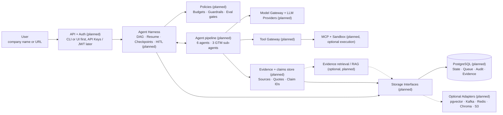

# VentureOS | Dev branch

> ### **From a company name to end2end loop**

VentureOS is a business operations harness that is designed to coordinate agents to analyze a company and the market it operates in, assess its strengths and weaknesses in market positioning, identify the clients it targets, build a GTM and sales strategy for them, and produce a simple mini-MVP of a similar solution. Built for small B2B agencies and technical consultancies connecting research, sales preparation, and delivery across disconnected tools.

- A company name or website (required). `http://` is upgraded to `https://`, and the change is recorded.
- Optional instructions, for example `focus on mid-market` or `EU only`.
- Optional, on a re-run: a previous run ID and a list of gaps (for example `market.trends`), so only missing items are researched.

<p align="center">
  
</p>

User flow (planned):
1. Input: company name or URL
2. Research agent: collects sourced evidence about the company until it has enough context
3. GTM orchestrator: runs market analysis, competitive strategy, and challenger salesman in parallel
4. PM agent: turns their outputs into a company snapshot; if any field is missing, a human decides to research more or proceed (HITL 1)
5. Presentation and Product builders: create a 1-pager proposal and a mini-MVP in parallel, then a human approves both (HITL 2)
6. Executor: a mini AI CRM that runs approved follow-up and tracks all work

| Field | Checklist (checked in code) |
| --- | --- |
| Company | name, website, what they sell |
| Market | category, 1 or more size or growth signals, 2 or more trends |
| Competitors | 3 to 5 alternatives, each with website, positioning, and pricing (or `not_published`) |
| Sales | target customer, buyer role, pricing model, channel; buying signals optional |



1. **Understand.** Normalize a given website and start research. With only a name, run 1 search and 1 model call to check the spelling (for example `Baseteen` becomes `Baseten`) and propose up to 5 official websites. The run stops with `clarify`; research starts after the user picks a website, and the typed spelling still counts as the company's name.
2. **Reason (ReAct, DeepAgents).** The research loop is a [DeepAgents](https://docs.langchain.com/oss/python/deepagents/overview) agent on Claude Haiku 5.5. The model decides what to search and read next, starting with the company's own site, then market, then competitors. It works only through 5 tools: `coverage_status`, `search_web`, `read_source`, `add_evidence`, and `note_gap`. Code validates every tool call; a search may target only the company's site, a known competitor's site, or a site already collected.
3. **Act: search and collect.** Each `search_web` call is 1 stored round. Keep at most 3 pages per search, preferring new sites. Skip duplicates (ignoring `www.`), non-public or non-HTTPS URLs, and low-value pages on any site (careers, benefits, legal, sign-in, PDFs). Reject pages about a different company (typed, confirmed, and domain names all count), except category market reports in market searches, which may support market items only. Competitor pages count only from the competitor's own site or a pricing, comparison, or review page about it. Caps: 3 general, 2 pricing, 2 customer, and 1 funding or launch page from the company site; 2 general pages plus 1 pricing page per other site; 5 competitors.
4. **Observe: read and record.** The model reads a source with `read_source` and records items with `add_evidence`; a rejected item comes back with the reason so it can fix it. Only direct competitors are recorded (the model labels each one direct or adjacent), and only from comparison, alternatives, review, or competitor pages. Competitors are rejected when the excerpt describes an acquisition, integration, or partnership, or when the competitor published the page. Competitor pricing must state a price; forum posts cannot supply competitor positioning or pricing. Competitors are ranked by how many sources name them, and details are required for the top 3.
5. **Check coverage.** Code, not the model, recomputes coverage and stores a snapshot.
6. **Repeat** until every field is complete or a limit is hit: 12 searches, 36 sources, 36 model calls. Hitting a limit returns a `partial` pack with its gap list, never an error. The Anthropic client retries rate limits and server errors with backoff.

Evidence rules enforced in code: excerpts are 25 to 400 characters and appear verbatim in their source; each excerpt supports 1 item (a list of competitors may support 1 item per competitor); names and numbers in a statement must appear in its excerpt; facts from forums become inferences; company offering and pricing model must cite the company's own site when one was collected. Page text is treated as untrusted data.

The harness is deterministic code, not an LLM agent. It runs the agents as a pipeline, applies eval gates between stages, and pauses for human-in-the-loop (HITL) decisions before work moves on or leaves the system.

<details>
<summary>Same pipeline as a Mermaid diagram</summary>


</details>

Pipeline rules (planned):

- Research is a ReAct loop (reason, search, observe) that stops when it has enough context for the downstream agents or reaches its search budget.
- The GTM orchestrator passes the full research context to 3 sub-agents that run in parallel, then hands their combined outputs to the PM agent.
- The PM agent assembles a company snapshot. If every required field is filled, the pipeline continues to the builders automatically. If any field is empty, HITL 1 asks a human to send the gaps back to Research or proceed with the gaps marked as unknown.
- Downstream agents cite claim IDs from the evidence store. Anything without a citation is labeled a hypothesis.
- An eval gate checks each stage output before the next stage starts.
- Presentation Builder and Product Builder run in parallel. Product Builder writes a spec first, builds from a fixed scaffold in a sandbox, and records a demo GIF. It solves the same job as the target product and does not copy it.
- HITL 2 approves the proposal and prototype before the Executor acts.
- Executor is a mini AI CRM: it tracks contacts, deals, and follow-ups, and drafts and dry-runs email and onboarding steps. Real sends require approval.

Architecture details:

- [Storage defaults and interfaces](docs/architecture/storage.md)
- [Optional adapters](docs/architecture/adapters.md)
- [Safety and runtime policies](docs/architecture/safety.md)

## 6 agents. 3 GTM sub-agents. 1 harness.

## Run

| #  | Agent                | Responsibility                                                                                                                   | Deliverable                     |
| -- | -------------------- | -------------------------------------------------------------------------------------------------------------------------------- | ------------------------------- |
| 1  | Research             | ReAct agent that collects information about the company, its industry, and trends from a name or URL until it has enough context | Sourced evidence and claims     |
| 2  | GTM orchestrator     | Runs the 3 GTM sub-agents in parallel on the research context and combines their outputs                                         | Combined GTM analysis           |
| 2a | Market analysis      | Size and segment the market, trends, and buying signals                                                                          | Market overview                 |
| 2b | Competitive strategy | Compare alternatives, pricing, positioning, and gaps                                                                             | Ranked opportunity hypotheses   |
| 2c | Challenger salesman  | Define the ICP, commercial insight, GTM and sales strategy, and tailored outreach                                                | ICP, offer, and outreach drafts |
| 3  | PM agent             | Turn GTM outputs into a company snapshot and check that every field is filled; trigger HITL when it is not                       | Company snapshot with claim IDs |
| 4  | Presentation builder | Package the offer and unique value proposition                                                                                   | 1-pager proposal                |
| 5  | Product builder      | Build a scoped mini-MVP of a similar solution                                                                                    | Tested prototype and demo GIF   |
| 6  | Executor             | Mini AI CRM: track contacts, deals, and follow-ups, and run approved outreach and onboarding steps                               | Action records and outcome data |

Role contracts in `agents/` still follow the earlier layout. Contracts for the GTM orchestrator, Market analysis, and PM agent are planned. The preview harness returns a fixed workflow plan that still lists the earlier 6-agent set. The separate RuntimeHarness executes trusted registered plugins with PostgreSQL state, permissions, runtime validation, bounded retries, tracing interfaces, and task approval. Dynamic business-agent routing remains (planned).

## Quick start

Requires Python 3.10+. No dependencies or API keys are needed for the preview.

Start the FastAPI backend, then the Streamlit UI in a second terminal:

```bash
PYTHONPATH=src python3 -m research.api
```

This prints a JSON workflow plan showing agent assignments, review checkpoints, and expected deliverables. It does not call models, browse the web, send email, or build a product.

## Project structure

```text
agents/                  agent contracts in the earlier 6-agent layout (new pipeline contracts planned)
src/ventureos/
  agents.py              Agent registry
  contracts.py           Shared brief and workflow types
  harness.py             Workflow preview and execution boundary
  __main__.py            Local preview command
integrations/            Future model, research, email, and CRM adapters
docs/architecture.md     Execution model and acceptance criteria
docs/architecture/       Storage, adapters, and safety (planned)
examples/agency-brief.json
```

## Roadmap

- [X] Define the earlier 6 agent roles and workflow contracts
- [X] Add a local workflow preview
- [ ] Connect a model provider and sourced research tools
- [X] Implement shared task state, runtime validation, budget reservations, and lease recovery
- [X] Implement hash-bound task approval gates
- [ ] Implement customer-feedback branching
- [ ] Define contracts for the GTM orchestrator, Market analysis, and PM agent, and the evidence and claims schema
- [ ] Add the evidence and claims store with claim IDs
- [ ] Add eval gates between pipeline stages
- [ ] Run the GTM sub-agents in parallel and merge their outputs
- [ ] Implement the PM snapshot completeness check with HITL 1 (research more or proceed) and HITL 2 approval
- [ ] Ship a thin end-to-end slice for 1 company across all agents and sub-agents
- [ ] Run the Executor in draft and dry-run mode with mock adapters
- [ ] Add email and CRM adapters with duplicate-action prevention
- [ ] Publish a reproducible end-to-end example with cost and outcome data

- **Chat:** send a company name or website. For a name, the agent checks the spelling and proposes websites (reply with a number, name, or website) or when the pack is partial (reply `yes` to research only the missing items). Packs are shown with coverage, cited evidence, and a JSON download.
- **Data management:** every stored run, with its evidence pack, each round's query and coverage, and kept and rejected sources.

The backend binds to `127.0.0.1` and has no authentication, so run it on your own machine. Chat sessions are in memory; runs and packs are in the store.

| Endpoint | Purpose |
| --- | --- |
| `POST /api/sessions` | Start a chat session |
| `POST /api/sessions/{id}/messages` | Send `{"message", "instructions"}`; returns a job ID |
| `GET /api/jobs/{id}?after=N` | Progress events and the reply |
| `GET /api/runs` | Stored runs, newest first |
| `GET /api/runs/{id}` | 1 run and its evidence pack |
| `GET /api/runs/{id}/rounds` | Rounds, coverage per round, and sources |

A CLI is also available: `PYTHONPATH=src python3 -m research "Basecamp" --website basecamp.com`.

`research.pack.gtm_gaps(pack)` lists what still blocks the GTM agents (at least 1 cited item per section and 3 described competitors; buying signals optional). A live smoke check researches real companies and scores each pack; it makes billed calls and is not part of the tests:

```bash
PYTHONPATH=src python3 scripts/live_smoke.py linear.app baseten.co vercel.com
```

Tests use provider doubles and never call live services; they cover the shared rules, storage, API, and the fallback loop, not the live DeepAgents loop, which the smoke check covers. Set `RESEARCH_TEST_DATABASE_URL` to a disposable database to run the PostgreSQL tests.

```bash
PYTHONPATH=src python3 -m unittest discover -s tests -v
```

## Status

- Implemented: input normalization, name check with website options, DeepAgents research loop on Claude Haiku 5.5, evidence checks, checklist coverage, re-runs from gaps, PostgreSQL and in-memory storage, FastAPI backend, Streamlit chat and data management UI, CLI.
- Planned: updated golden fixture, a model check that a statement follows from its excerpt, pgvector retrieval.
