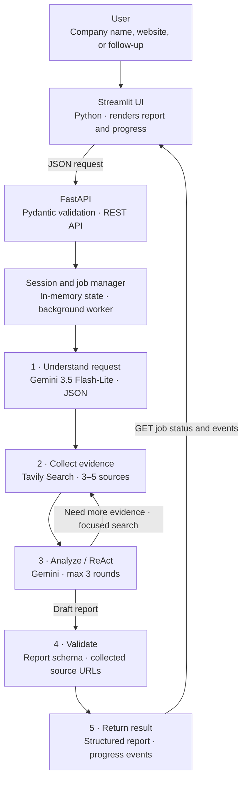
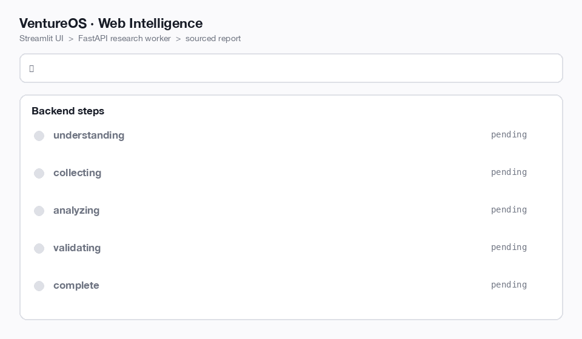

# VentureOS | Web Intelligence agent

This branch is scoped for **Web Intelligence** agent - a company-research agentic workflow.

The Streamlit app is a visualization client; the FastAPI backend owns request
understanding, web search, report generation and validation, session state, and
follow-up answers.

## Versioning

Current release: **V.0.3** (package version `0.3.0` in `pyproject.toml`).
Increment the version by `0.1` for every subsequent update published to GitHub:
the next published update is **V.0.4** (`0.4.0`). Keep this section, the
versioning rule in `AGENTS.md`, and the package version in sync.

## Architecture



Follow-up messages re-enter the same backend flow and are answered from the
accepted report and collected evidence.

## ReAct workflow

The backend runs one bounded research worker rather than several independent model-driven subagents. It classifies the request, collects 3 to 5 distinct sources, analyzes the evidence, and can request another focused search for up to 3 rounds. Every step emits input, output, and a success/failure status for the UI. The shared evidence set keeps follow-ups grounded in the same sources. Splitting this into separate agents is a future option only if the workflow needs independent permissions or parallel research.

Tavily supplies search results and extracted page text; the backend retains source URLs and retrieval timestamps. The report lists only URLs returned by search and collected by the worker.

The final report uses the golden-data shape: company, problem, market, ICP,
solution, positioning, and source URLs. [The golden fixture](tests/agents_data/web_intelligence_golden_data.json) is test reference data only; the app never uses it as a live response.

## Demo result



Live run on V.0.2 for the message *"Explore the company Stripe for me - http://stripe.com/"*.
The `http://` link was upgraded to `https://` during request understanding.
Live output varies between runs, so treat this as an example, not a fixed response.

### [Stripe](https://www.stripe.com/)

Stripe is a financial services platform that helps all types of businesses accept
payments, build flexible billing models, and manage money movement.

> **Value proposition:** Stripe builds economic infrastructure for the internet,
> helping businesses accept payments and manage financial operations globally.

**Problem.** Businesses struggle with accepting online payments, managing recurring
revenue, handling global compliance, and orchestrating complex money movement
across channels.

- Complexities in integrating multiple payment methods and currencies
- Managing fraud and preventing transaction losses
- Setting up recurring billing models and subscription management
- Handling global tax calculations and regulatory compliance

| | |
|---|---|
| **Market** | Technology, Information and Internet · Fintech & Payments |
| **Business model** | Pay-as-you-go transactional fees and custom enterprise packaging |
| **Target client** | Digital-first businesses, e-commerce stores, and software platforms |
| **ICP buyer** | Founders, Chief Financial Officers, and Engineering Leaders |
| **End users** | Developers integrating payment APIs · Finance teams managing reconciliation and billing · End customers checking out online or via mobile |

**Solution — Stripe Financial Services Platform.** Programmable APIs, prebuilt UI
components, and developer tools to embed payments, billing, and money management
into any application or website.

**Sources** (all collected by the research worker):

1. [tavily.com — Stripe company profile](https://tavily.com/knowledge/company/igPwhNOUwEGy)
2. [leadiq.com — Stripe company page](https://leadiq.com/c/stripe/5a1d892d240000240062acad/email-format)
3. [stripe.com/pricing](https://stripe.com/pricing)

## Run locally

Python 3.10+ is required. Install the branch's API and UI dependencies:

```bash
python3 -m venv .venv
.venv/bin/python -m pip install -e '.[chat,ui,test]'
```

Configure a Tavily key and Gemini API key in the shell or root `.env`. The
default model is Gemini 3.5 Flash-Lite (`gemini-3.5-flash-lite`), the current
stable Flash-Lite API model. Google lists it separately from Gemini 3.8 Flash;
there is no Gemini 3.8 Flash-Lite text model in its current model catalog.
Availability and free quotas depend on the Google AI Studio project and account.

```bash
export TAVILY_API_KEY="..."
export GEMINI_API_KEY="..."
export GEMINI_MODEL="gemini-3.5-flash-lite"
PYTHONPATH=src .venv/bin/python -m web_intelligence.api
```

In another terminal:

```bash
PYTHONPATH=src .venv/bin/streamlit run UI/app.py --server.address 127.0.0.1
```

The API and UI bind to loopback by default. Sessions are held in process memory
and disappear on restart. This prototype has no authentication and is not
suitable for public deployment. Do not expose it to an untrusted network.

## Local API

- `POST /api/sessions` creates an in-memory conversation.
- `POST /api/sessions/{session_id}/messages` accepts `{"message":"Stripe"}` and
  returns a job ID.
- `GET /api/jobs/{job_id}?after=0` returns progress events and the final result.
  Each event includes `module`, `input`, `output`, and `status`.
- `GET /api/sessions/{session_id}` returns conversation history.

The backend is also available as `web-intelligence-api` after installation.

## Verify

Tests use provider doubles and the golden file; they do not call live services:

```bash
PYTHONPATH=src .venv/bin/python -m unittest discover -s tests -p 'test_web_intelligence.py' -v
```
