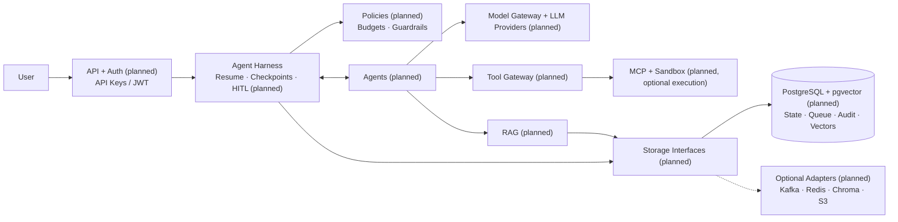

# VentureOS

### From market research to a customer-ready offer and prototype.

VentureOS is a business operations harness that is designed to coordinate 6 specialized AI agents (planned) to turn a target market into an evidence-backed offer, tailored outreach, and a working prototype.

Built for small B2B agencies and technical consultancies connecting research, sales preparation, and delivery across disconnected tools.

> **Status: early scaffold.** The workflow preview runs locally without credentials. AI execution, live research, integrations, approvals, and persistence are planned; no business actions are executed yet.

## Architecture

**Postgres only by default, scale with optional adapters (planned).** Local disk holds files. The current implementation is a credential-free workflow preview; the runtime below is planned.



Cross-cutting: OpenTelemetry tracing · Offline eval harness as a CI release gate (planned)

Architecture details:

- [Storage defaults and interfaces](docs/architecture/storage.md)
- [Optional adapters](docs/architecture/adapters.md)
- [Safety and runtime policies](docs/architecture/safety.md)

## 6 agents. 1 harness.

Agent execution and deliverables below are (planned); role specifications and a fixed workflow preview exist today.

| Agent | Responsibility | Deliverable |
| --- | --- | --- |
| Web Intelligence | Research companies, problems, trends, and buying signals | Sourced evidence brief |
| Competitive Strategy | Compare alternatives, pricing, positioning, and gaps | Ranked opportunity hypotheses |
| Challenger Salesman | Define the ICP, commercial insight, and tailored outreach | ICP, offer, and outreach drafts |
| Presentation Builder | Package the approved offer and unique value proposition | Concise proposal |
| Product Builder | Build a scoped prototype, integrations, code, and tests | Tested prototype |
| Workflow Automation | Execute approved email, CRM, onboarding, and delivery steps | Action records and outcome data |

The harness currently returns a fixed workflow plan. Dynamic routing, shared state, permissions, runtime evaluation, bounded retries, tracing, and human approval are (planned).

## Quick start

Requires Python 3.10+. No dependencies or API keys are needed for the preview.

Run from the repository root:

```bash
PYTHONPATH=src python3 -m ventureos --brief examples/agency-brief.json
```

This prints a JSON workflow plan showing agent assignments, review checkpoints, and expected deliverables. It does not call models, browse the web, send email, or build a product.

## Project structure

```text
agents/                  6 agent instruction and output contracts
src/ventureos/
  agents.py              Agent registry
  contracts.py           Shared brief and workflow types
  harness.py             Workflow preview and execution boundary
  __main__.py            Local preview command
integrations/            Future model, research, email, and CRM adapters
docs/architecture.md     Execution model and acceptance criteria
docs/architecture/       Storage, adapters, and safety (planned)
examples/agency-brief.json
```

## Roadmap

- [x] Define 6 agent roles and workflow contracts
- [x] Add a local workflow preview
- [ ] Connect a model provider and sourced research tools
- [ ] Implement persistent run state, evaluation, budgets, and recovery
- [ ] Implement approval gates and customer-feedback branching
- [ ] Add email and CRM adapters with duplicate-action prevention
- [ ] Publish a reproducible end-to-end example with cost and outcome data

## Contributing

Start with one workflow, agent contract, or adapter. Include a sample input, expected output, and a way to verify the result. Keep generated claims separate from sourced facts and observed customer outcomes.

## Inspiration

README organization and architecture references: [MetaGPT](https://github.com/FoundationAgents/MetaGPT), [CrewAI](https://github.com/crewAIInc/crewAI), [AutoGen](https://github.com/microsoft/autogen) (historical reference), [LangGraph](https://github.com/langchain-ai/langgraph), and [Agency Swarm](https://github.com/VRSEN/agency-swarm). These are references, not dependencies or affiliations.
