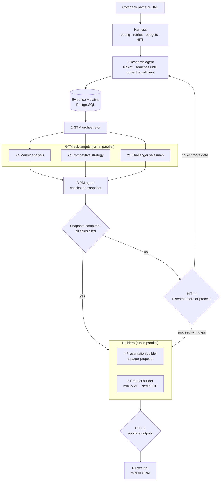
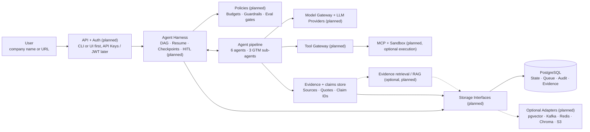

# VentureOS | Dev branch

> ### **From a company name to end2end loop**

VentureOS is a business operations harness that is designed to coordinate agents to analyze a company and the market it operates in, assess its strengths and weaknesses in market positioning, identify the clients it targets, build a GTM and sales strategy for them, and produce a simple mini-MVP of a similar solution. Built for small B2B agencies and technical consultancies connecting research, sales preparation, and delivery across disconnected tools.

## Status

| # | Agent | Status | Version | Package |
| -- | --- | --- | --- | --- |
| 1 | Research | Implemented | V.0.3 | `src/research/` |
| 2 | GTM orchestrator (market analysis, competitive strategy, challenger salesman, company snapshot) | Implemented | V.0.4 | `src/gtm/` |
| 3 | PM agent (baseline, HITL 1, use case, action plan, builder briefs) | Implemented | V.0.1 | `src/pm/` |
| 4 | Presentation builder | Planned | | |
| 5 | Product builder | Planned | | |
| 6 | Executor | Planned | | |
| | Pipeline: Research to GTM to PM in 1 run (first harness slice) | Implemented | V.0.2 | `src/pipeline/` |
| | Rest of the harness: eval gates, HITL 1 and 2, routing to later agents | Planned | | |

The pipeline runs Research, the GTM orchestrator, and the PM agent in 1 command, passing each result straight to the next, so 1 company name or URL produces the evidence pack, the strategy pack with the company snapshot, and the PM result: the use case ("Help {ICP} solve {core problem} with {MVP solution}"), the action plan, and the builder briefs. When PM's baseline fails, the run stops at HITL 1 for a decision (`research` or `proceed`). The rest of the harness (eval gates, HITL 2, and the later agents) is planned. The UI runs the same flow in the chat.

### Progress

- **Works end to end:** company name or URL → Research evidence pack → GTM strategy pack with company snapshot → PM use case, action plan, and builder briefs, from the CLI (`python -m pipeline`) and from the UI chat.
- **Tested:** 113 offline tests pass (21 PostgreSQL tests run only in CI).
- **Not yet chained:** HITL 2, eval gates, and agents 4 to 6. A HITL 1 `research` decision returns the gaps, but the Research re-run is still started by hand.
- **Storage:** without `RESEARCH_DATABASE_URL`, runs live in memory and are lost when the API restarts; GTM results are saved to `runs/gtm/`.

### Output quality (latest review, Notion run)

The output is structurally complete and honest about evidence, but the strategy is still thin. Overall about 6/10: good for demonstrating the mechanics, not yet convincing as strategy.

- **Strong:** every section filled, the real mission found, 14 of 18 recommendations correctly labeled `hypothesis`, each competitive hypothesis with disconfirming evidence and a validation question, 18 recommendations merged into 12 themes.
- **Contradiction:** sub-agents report "mission not retrieved" while the snapshot shows it, because their evidence filters exclude `company.mission` and `company.problem`.
- **Market category may be wrong:** Notion was sized as project management software; the sub-agents flag the fit as unconfirmed, but the snapshot's market brief presents it as evidence-based.
- **ICP restates pricing tiers:** no roles, industries, or pains; the ICP line nearly repeats the target market line.
- **Pricing-heavy analysis:** all 4 competitive hypotheses are about price or packaging, with close scores (8 to 11 of 20).
- **Thin competitor evidence:** all competitor prices come from 1 third-party article; Asana's own site was not checked.
- **Snapshot wording:** the product line is a tagline, "how it helps clients" repeats the problem, and the market brief and landscape lines end with advice although a snapshot should only describe.

## Architecture

<p align="center">
  
</p>

User flow:
1. Input: company name or URL
2. Research agent (implemented): collects sourced evidence about the company until it has enough context
3. GTM orchestrator (implemented): runs market analysis, competitive strategy, and challenger salesman in parallel, then writes a cited company snapshot
4. PM agent (implemented): checks the strategy pack against a minimum baseline; if anything is missing, a human decides to research more or proceed (HITL 1); then establishes 1 use case ("Help {ICP} solve {core problem} with {MVP solution}") and an action plan
5. Presentation and Product builders (planned): create a 1-pager proposal and a mini-MVP in parallel, then a human approves both (HITL 2)
6. Executor (planned): a mini AI CRM that runs approved follow-up and tracks all work

The harness is deterministic code, not an LLM agent. It will run the agents as a pipeline, apply eval gates between stages, and pause for human-in-the-loop (HITL) decisions before work moves on or leaves the system.

<details>
<summary>Same pipeline as a Mermaid diagram</summary>



</details>

<details>
<summary>Target runtime (planned)</summary>



</details>

Pipeline rules:

- Research is a ReAct loop (reason, search, observe) that stops when it has enough context for the downstream agents or reaches its search budget. (Implemented)
- The GTM orchestrator passes the research context to 3 sub-agents that run in parallel, merges their outputs, and writes a cited company snapshot for the PM agent. (Implemented)
- The PM agent checks the company snapshot. If every required field is filled, the pipeline continues to the builders automatically. If any field is empty, HITL 1 asks a human to send the gaps back to Research or proceed with the gaps marked as unknown. (Planned)
- Downstream agents cite evidence IDs from the evidence pack. Anything not directly supported by its evidence is labeled a hypothesis.
- An eval gate checks each stage output before the next stage starts. (Planned)
- Presentation Builder and Product Builder run in parallel. Product Builder writes a spec first, builds from a fixed scaffold in a sandbox, and records a demo GIF. It solves the same job as the target product and does not copy it. (Planned)
- HITL 2 approves the proposal and prototype before the Executor acts. (Planned)
- Executor is a mini AI CRM: it tracks contacts, deals, and follow-ups, and drafts and dry-runs email and onboarding steps. Real sends require approval. (Planned)

## 6 agents. 3 GTM sub-agents. 1 harness.

| #  | Agent                | Responsibility                                                                                                                   | Deliverable                     |
| -- | -------------------- | -------------------------------------------------------------------------------------------------------------------------------- | ------------------------------- |
| 1  | Research             | ReAct agent that collects information about the company, its industry, and trends from a name or URL until it has enough context | Sourced evidence pack           |
| 2  | GTM orchestrator     | Runs the 3 GTM sub-agents in parallel on the research context, merges their outputs, and writes the company snapshot             | Strategy pack with snapshot     |
| 2a | Market analysis      | Market category, size and growth, trends, and which segments to prioritize                                                       | Market recommendations          |
| 2b | Competitive strategy | Compare alternatives, pricing, positioning, and gaps                                                                             | Ranked opportunity hypotheses   |
| 2c | Challenger salesman  | Define the ICP, commercial insight, GTM and sales motion, and tailored outreach                                                  | ICP, motion, and outreach angles |
| 3  | PM agent             | Check that every field of the company snapshot is filled; trigger HITL when it is not                                            | Approved snapshot or HITL 1     |
| 4  | Presentation builder | Package the offer and unique value proposition                                                                                   | 1-pager proposal                |
| 5  | Product builder      | Build a scoped mini-MVP of a similar solution                                                                                    | Tested prototype and demo GIF   |
| 6  | Executor             | Mini AI CRM: track contacts, deals, and follow-ups, and run approved outreach and onboarding steps                               | Action records and outcome data |

## Agent 1: Research (V.0.3)

**Input**

- A company name or website (required). `http://` is upgraded to `https://`, and the change is recorded.
- Optional instructions, for example `focus on mid-market` or `EU only`.
- Optional, on a re-run: a previous run ID and a list of gaps (for example `market.trends`), so only missing items are researched.

**Output:** an evidence pack (schema v4, `src/research/pack.schema.json`) whose sections are checked against this checklist in code:

| Field | Checklist (checked in code) |
| --- | --- |
| Company | name, website, what they sell, mission, problem they solve; vision optional (mission and vision must cite the company site) |
| Market | category, 1 or more size or growth signals, 2 or more trends |
| Competitors | 3 to 5 alternatives, each with website, positioning, and pricing (or `not_published`) |
| Sales | target customer, buyer role, pricing model, channel; buying signals optional |

**How it works**

1. **Understand.** Normalize a given website and start research. With only a name, run 1 search and 1 model call to check the spelling (for example `Baseteen` becomes `Baseten`) and propose up to 5 official websites. The run stops with `clarify`; research starts after the user picks a website, and the typed spelling still counts as the company's name.
2. **Reason (ReAct, DeepAgents).** The research loop is a [DeepAgents](https://docs.langchain.com/oss/python/deepagents/overview) agent on Claude Haiku 5.5. The model decides what to search and read next, starting with the company's own site, then market, then competitors. It works only through 5 tools: `coverage_status`, `search_web`, `read_source`, `add_evidence`, and `note_gap`. Code validates every tool call; a search may target only the company's site, a known competitor's site, or a site already collected.
3. **Act: search and collect.** Each `search_web` call is 1 stored round. Keep at most 3 pages per search, preferring new sites. Skip duplicates (ignoring `www.`), non-public or non-HTTPS URLs, and low-value pages on any site (careers, benefits, legal, sign-in, PDFs). Reject pages about a different company (typed, confirmed, and domain names all count), except category market reports in market searches, which may support market items only. Competitor pages count only from the competitor's own site or a pricing, comparison, or review page about it. Caps: 3 general, 2 pricing, 2 customer, and 1 funding or launch page from the company site; 2 general pages plus 1 pricing page per other site; 5 competitors.
4. **Observe: read and record.** The model reads a source with `read_source` and records items with `add_evidence`; a rejected item comes back with the reason so it can fix it. Only direct competitors are recorded (the model labels each one direct or adjacent), and only from comparison, alternatives, review, or competitor pages. Competitors are rejected when the excerpt describes an acquisition, integration, or partnership, or when the competitor published the page. Competitor pricing must state a price; forum posts cannot supply competitor positioning or pricing. Competitors are ranked by how many sources name them, and details are required for the top 3.
5. **Check coverage.** Code, not the model, recomputes coverage and stores a snapshot.
6. **Repeat** until every field is complete or a limit is hit: 12 searches, 36 sources, 36 model calls. Hitting a limit returns a `partial` pack with its gap list, never an error. The Anthropic client retries rate limits and server errors with backoff.

Evidence rules enforced in code: excerpts are 25 to 400 characters and appear verbatim in their source; each excerpt supports 1 item (a list of competitors may support 1 item per competitor); names and numbers in a statement must appear in its excerpt; facts from forums become inferences; company offering and pricing model must cite the company's own site when one was collected. Page text is treated as untrusted data.

`research.pack.gtm_gaps(pack)` lists what still blocks the GTM agents (at least 1 cited item per section and 3 described competitors; buying signals optional).

## Agent 2: GTM orchestrator (V.0.4)

**Input:** a Research evidence pack (schema v4) as a JSON file, plus optional instructions such as a target region or segment. The orchestrator never searches the web.

**Sub-agents.** 3 sub-agents run in parallel, and all act as consultants advising the researched company:

- **Market analysis:** category, size and growth signals, trends, and which segments to prioritize.
- **Competitive strategy:** compares alternatives, pricing, positioning, and gaps, and returns opportunity hypotheses. Each has sub-scores (`pain`, `gap_size`, `competitor_weakness`, `fit`, 1 to 5), disconfirming evidence, and a validation question. Code computes `score` (the sum, 4 to 20) and `rank`.
- **Challenger salesman:** ICP and buyer, a commercial insight that reframes the buyer's problem, the sales motion, and outreach angles.

Each sub-agent sees only the evidence tagged for its purpose, and every recommendation must cite those evidence IDs and be labeled `evidence_based` or `hypothesis`. Invalid output gets 1 corrective retry; a sub-agent that still fails is marked `failed` and the run continues.

**Merge step.** 1 model call groups overlapping recommendations into themes and de-duplicates gaps. The model only groups existing IDs and never rewrites content; code validates the grouping and falls back to exact de-duplication if it fails.

**Company snapshot.** After the merge step, 1 model call writes the snapshot: company name and URL, mission and vision (1 bullet each), the problem the company solves (1 line), target market and ICP (1 line each), product and how it helps clients (1 line each), a market analysis brief, and the competition landscape. Code decides which evidence and recommendations each line may cite; a line with nothing to cite is `unknown` and is never sent to the model, so the snapshot cannot invent a mission or vision. Each line is validated separately: a line over its length limit is trimmed to the whole sentences that fit, invalid lines get 1 retry with their errors, valid lines are always kept, and lines that still fail become `unknown` (listed in `line_errors`). Only a response that is not usable at all, twice, gives a `fallback` snapshot of `unknown` lines.

**Output:** a strategy pack (schema v4) with the company snapshot, recommendations (each with an ID), themes, ranked hypotheses, de-duplicated gaps, Research gaps, and per-sub-agent results. Status is `complete` when Research is complete, every sub-agent returned at least 1 recommendation, and every required snapshot line is filled (vision is optional); otherwise `partial`.

## Quick start

Requires Python 3.11+. Install all extras in a virtual environment:

```bash
python3 -m pip install -e '.[research,api,ui,test]'
```

Copy `.env.example` to `.env` and set `ANTHROPIC_API_KEY` and `TAVILY_API_KEY`. `RESEARCH_MODEL` defaults to `claude-haiku-5-5`; set `RESEARCH_DATABASE_URL` to store runs in PostgreSQL instead of memory. Live runs make billed API calls.

**API and UI.** Start the pipeline backend (all Research endpoints plus GTM), then the Streamlit UI in a second terminal:

```bash
PYTHONPATH=src python3 -m pipeline.api
```

```bash
streamlit run UI/app.py
```

- **Chat:** send a company name or website. For a name, the agent checks the spelling and proposes websites (reply with a number, name, or website) or, when the pack is partial, asks whether to research only the missing items (reply `yes`). Packs are shown with coverage, cited evidence, and a JSON download. When Research returns a pack, GTM starts automatically and the chat shows the company snapshot, then tabs for competitive analysis (ranked hypotheses), sales strategy, market analysis, and themes and gaps, with a strategy JSON download. GTM then hands the strategy pack to PM, and the chat shows the use case, why, key assumption, action plan, and the presentation and product briefs. When PM's baseline fails, **Research more** and **Proceed with gaps** buttons answer HITL 1.
- **Data management:** every stored run, with its evidence pack, its GTM strategy (or a button to run GTM on it), its PM plan (or a button to run PM), each round's query and coverage, and kept and rejected sources. GTM results are saved to `runs/gtm/<research run id>.json` and PM results to `runs/pm/<research run id>.json`.

The backend binds to `127.0.0.1:8000` and has no authentication, so run it on your own machine. Chat sessions are in memory; runs and packs are in the store.

| Endpoint | Purpose |
| --- | --- |
| `POST /api/sessions` | Start a chat session |
| `POST /api/sessions/{id}/messages` | Send `{"message", "instructions"}`; returns a job ID |
| `GET /api/jobs/{id}?after=N` | Progress events and the reply |
| `GET /api/runs` | Stored runs, newest first |
| `GET /api/runs/{id}` | 1 run and its evidence pack |
| `GET /api/runs/{id}/rounds` | Rounds, coverage per round, and sources |
| `POST /api/gtm/runs` | Send `{"research_run_id", "instructions"}`; runs GTM on that stored pack and returns a job ID |
| `GET /api/gtm/jobs/{id}` | GTM job status and the strategy pack |
| `GET /api/gtm/runs/{research_run_id}` | The saved strategy pack for a research run, if any |
| `POST /api/pm/runs` | Send `{"research_run_id", "decision", "instructions"}` (`decision` is optional: `proceed` or `research`); runs PM on the saved strategy pack |
| `GET /api/pm/jobs/{id}` | PM job status and the PM result |
| `GET /api/pm/runs/{research_run_id}` | The saved PM result for a research run, if any |

**Research: CLI.** Prints the run status and the evidence pack as JSON:

```bash
PYTHONPATH=src python3 -m research "Basecamp" --website basecamp.com
```

**Full flow: pipeline.** 1 command runs Research, the GTM orchestrator on its evidence pack, then PM on the strategy pack:

```bash
PYTHONPATH=src python3 -m pipeline Linear --website linear.app
```

It writes `runs/<company>-research.json` (the evidence pack), `runs/<company>-gtm.json` (the strategy pack with the company snapshot), and `runs/<company>-pm.json` (the use case, action plan, and builder briefs). If PM's baseline fails, the run stops at HITL 1 (exit code 5); run it again with `--decision proceed` or `--decision research`. `--no-pm` stops after GTM. Add `--instructions` to scope both agents and `--output-dir` to change the folder. Without `--website`, Research may ask you to pick the official website; the pipeline then prints the candidates and stops, so run it again with `--website`. A partial evidence pack is still analyzed, and GTM lists its gaps.

**GTM orchestrator: CLI.** Run it on a saved evidence pack (a JSON download from the UI, or a sample in `data/`):

```bash
PYTHONPATH=src python3 -m gtm data/notion.json --output runs/notion-gtm.json
```

Add `--instructions "Focus on B2B SaaS teams in Europe"` to scope the recommendations. Outputs go to `runs/`, which is git-ignored.

## Tests

Tests use provider doubles and never call live services. They cover both agents: Research rules, storage, API, and the fallback loop, and GTM validation, ranking, retries, merging, and the CLI. They do not cover the live DeepAgents loop or live model quality.

```bash
PYTHONPATH=src python3 -m unittest discover -s tests -v
```

Set `RESEARCH_TEST_DATABASE_URL` to a disposable PostgreSQL database to run the PostgreSQL tests; CI runs them. A live Research smoke check researches real companies and scores each pack; it makes billed calls and is not part of the tests:

```bash
PYTHONPATH=src python3 scripts/live_smoke.py linear.app baseten.co vercel.com
```

## Project structure

```text
src/research/            Agent 1: Research (loop, evidence rules, pack schema, store, API, CLI)
src/research/migrations/ PostgreSQL schema
src/gtm/                 Agent 2: GTM orchestrator (sub-agents, ranking, merge step, snapshot, CLI)
src/pm/                  Agent 3: PM agent (baseline, HITL 1, use case, DeepAgents planner, CLI)
src/pipeline/            First harness slice: runs Research, GTM, then PM, in 1 command
UI/                      Streamlit client for the pipeline API (Research and GTM)
data/                    Sample evidence packs used by the GTM tests
scripts/live_smoke.py    Live Research check (billed, not part of the tests)
tests/                   Offline tests for both agents
docs/architecture/       Pipeline picture
```

## Roadmap

- [x] Research agent: bounded ReAct loop, evidence rules, checklist coverage, re-runs from gaps, storage, API, UI, CLI
- [x] GTM orchestrator: 3 parallel sub-agents, code-ranked hypotheses, corrective retries, merge step, CLI
- [x] Company snapshot in the GTM strategy pack (mission, vision, problem, market, ICP, product, market brief, competition landscape)
- [x] Pipeline: Research to GTM to PM in 1 run (first harness slice)
- [x] GTM API and UI: the chat runs GTM after Research and shows the snapshot, competitive analysis, and sales strategy
- [x] PM agent: minimum baseline, HITL 1 (research more or proceed), use case, action plan, and builder briefs
- [ ] HITL 1 `research`: start the Research re-run from the gaps automatically
- [ ] Rest of the harness: eval gates between stages, HITL, and the later agents
- [ ] Presentation builder and Product builder, then HITL 2 approval
- [ ] Executor in draft and dry-run mode with mock adapters
- [ ] Email and CRM adapters with duplicate-action prevention
- [ ] Ship a thin end-to-end slice for 1 company across all agents
- [ ] Publish a reproducible end-to-end example with cost and outcome data

### TODO: output quality (next, in priority order)

1. [ ] GTM: give the sub-agents company mission, problem, and offering evidence, so they stop reporting the mission as missing.
2. [ ] GTM snapshot: keep lines descriptive (no advice), require the ICP to name roles or segments rather than pricing tiers, stop "how it helps clients" from repeating the problem, and flag an unconfirmed market fit in the market brief.
3. [ ] Research: check the market category against what the company sells before sizing the market.
4. [ ] Research: require competitor evidence from at least 2 independent sources and the competitor's own site.
5. [ ] GTM: require at least 1 Challenger salesman and 1 Competitive strategy item that is not about pricing (persona, pain, use case, or product gap).
6. [ ] Merge this branch (pipeline, GTM V.0.3 per-line snapshot validation, UI) into `dev` through a PR once CI passes.
