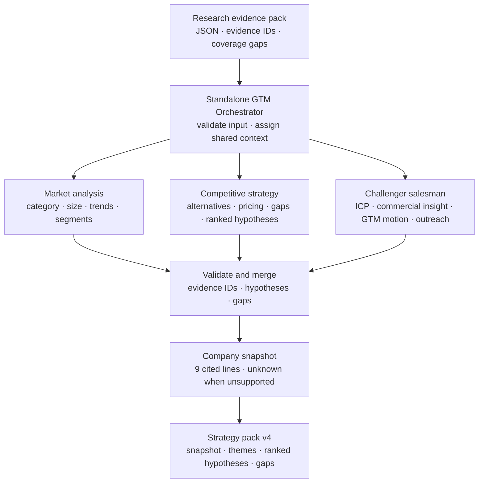

# VentureOS | GTM Orchestrator

> Version **V.0.2** (`0.2.0`, `src/gtm/__init__.py`). Branch `agents/GTM_orchestrator`.
> Each update published to GitHub increments the version by 0.1. The branch
> also carries the upstream Research agent (V.0.3), whose evidence-pack
> contracts GTM reuses.

This branch builds a standalone **GTM Orchestrator** and 3 focused sub-agents.
It accepts a Research evidence pack, analyzes only the supplied evidence, and
returns a combined strategy pack with evidence-linked recommendations.

The Research package is the upstream evidence producer; the GTM agent does not
search the web or alter Research data.

## Input

- A validated Research evidence pack (currently schema v4), including company
  details, cited evidence, market findings, competitors, sales context, and
  coverage gaps.
- Optional instructions such as target region, segment, or planning constraints.

Each conclusion must cite evidence IDs from the input pack. Unsupported
conclusions must be labeled as hypotheses; missing evidence must remain an
explicit gap, not be filled in by assumption.

## Sub-agents

All 3 sub-agents share 1 point of view: they act as consultants advising the
researched company (for example Notion) on its own market focus, competitive
position, and sales motion, not as a competitor or new entrant.

The orchestrator runs these 3 bounded analyses in parallel:

1. **Market analysis** (`market_analysis`): category, size and growth signals,
   key trends, and the segments most likely to buy.
2. **Competitive strategy** (`competitive_strategy`): compares alternatives,
   pricing, positioning, and gaps, and returns **ranked opportunity
   hypotheses**. Each hypothesis has `sub_scores` (`pain`, `gap_size`,
   `competitor_weakness`, `fit`, integers 1 to 5), `disconfirming_evidence`, and
   a `validation_question`. Code, not the model, computes `score` (the sum of
   the 4 sub-scores, 4 to 20) and `rank`; ties break by `pain`, then by evidence
   count.
3. **Challenger salesman** (`challenger_salesman`): ICP and buyer, a commercial
   insight that reframes the buyer's problem, the GTM and sales motion
   (channels, pricing and packaging, buying-signal triggers), and outreach
   angles.

If a sub-agent's output fails validation (for example an unknown evidence ID or
a missing sub-score), it gets 1 corrective retry with the error before it is
marked failed.

Each recommendation includes a basis (`evidence_based` or `hypothesis`) and
valid Research evidence IDs. The orchestrator records Research coverage gaps
and sub-agent failures, then combines successful results into one strategy
pack. It does not contact customers.

## Architecture



## Output

A JSON strategy pack (`schema_version` 4) contains the input run ID and company,
the company `snapshot`, each sub-agent result, merged recommendations (each with an `id` such as `r4`;
competitive strategy hypotheses in rank order, with `score` and `rank`),
`themes`, de-duplicated `gaps`, Research gaps, and any sub-agent errors.

**Company snapshot.** The top-level summary of the strategy pack, 1 model call
after the merge step:

| Line | May cite (decided in code) |
| --- | --- |
| Company name and URL | from the Research pack |
| `mission`, `vision` (1 bullet each) | Research `company.mission`, `company.vision` |
| `problem` (1 line) | Research `company.problem` |
| `target_market`, `icp` (1 line each) | Research target customer, category, buyer role; Challenger salesman recommendations for the ICP |
| `product`, `client_value` (1 line each) | Research offering and problem |
| `market_brief` (2 to 3 sentences) | Research market evidence and Market analysis recommendations |
| `competitive_landscape` (2 to 3 sentences) | Research competitor evidence and Competitive strategy recommendations |

A line with nothing to cite is `unknown` and is never sent to the model, so the
snapshot cannot invent a mission or a vision. Code checks every citation, label,
and length, retries once with the error, and otherwise falls back to a snapshot
where every line is `unknown` (`snapshot.status` is `fallback`). Vision is
optional because many companies publish only a mission; any other `unknown`
line makes the snapshot, and the strategy pack, `partial`.

**Merge step.** After the 3 sub-agents finish, 1 model call groups
recommendations that express the same idea into `themes` (a title, the
recommendation IDs, and the sub-agents involved) and groups duplicate gaps,
keeping 1 wording per group. The model only groups existing IDs; it never
rewrites a recommendation or a gap. Code checks that every recommendation and
gap lands in exactly 1 group. After 1 failed corrective retry, the merge falls
back to exact-text gap de-duplication and 1 theme per recommendation, and
`merge.status` is `fallback`; the run never fails because of the merge.
Research gaps are also de-duplicated in code, so a field is not listed both as
partial coverage and as a GTM gap.
The status is `complete` when the Research pack is complete with no coverage
gaps, every sub-agent returned at least 1 recommendation, and the snapshot is
complete. It is `partial` when Research is partial, a sub-agent failed or
returned no recommendations, or a required snapshot line is `unknown`. Evidence gaps that sub-agents report are listed in `gaps` but
do not make the result `partial`, because a real model almost always lists some.

## Run locally

Python 3.11+ is required. Install the Research, model, and CLI dependencies:

```bash
python3 -m pip install -e '.[research]'
```

Set `ANTHROPIC_API_KEY` for the default Claude model, or set `RESEARCH_MODEL` to
a Gemini model ID and provide `GEMINI_API_KEY`. Run either sample pack:

```bash
PYTHONPATH=src python3 -m gtm data/notion.json --output runs/notion-gtm.json
PYTHONPATH=src python3 -m gtm data/baseten.json --output runs/baseten-gtm.json
```

Optional instructions can scope the recommendations:

```bash
PYTHONPATH=src python3 -m gtm data/notion.json \
  --instructions "Focus on B2B SaaS teams in Europe"
```

Outputs are local JSON files under `runs/` by default; this MVP does not write
GTM results to PostgreSQL. API credentials and model calls may incur provider
costs.

## TO DO

- [X] **Step 1:** Validate the Research evidence-pack JSON inputs in `data/` and index
  their evidence IDs.
- [X] **Step 2:** Define and validate the structured GTM strategy-pack output contract.
- [X] **Step 3:** Implement Market analysis, Competitive strategy, and Challenger
  salesman model-backed sub-agents that only receive the supplied evidence pack.
- [X] **Step 4:** Implement an orchestrator that runs the 3 sub-agents in parallel,
  merges results, validates citations, and preserves Research coverage gaps.
- [X] **Step 5:** Add a CLI to run both sample packs and write merged strategy
  JSON under `runs/`.
- [X] **Step 6:** Add offline tests for both sample packs, valid and invalid citations,
  input gaps, and individual sub-agent failures.
- [X] **Step 7:** Align sub-agents with the VentureOS architecture: Market
  analysis, Competitive strategy with code-ranked hypotheses, and Challenger
  salesman.
- [X] **Step 8:** Add 1 corrective retry when a sub-agent's output fails validation.
- [x] **Step 9:** Run once against a live model (Notion sample, `runs/notion_gtm.json`).
- [x] **Step 10:** Fix issues from the live run: 1 shared advisory point of view
  for all sub-agents, stricter `evidence_based` labeling, and a status that can
  reach `complete`.
- [x] **Step 11:** Re-run live on both sample packs and review the output.
- [x] **Step 12:** Add a merge step that groups overlapping recommendations into
  themes and de-duplicates gaps.

### Progress

- Step 1 complete: `data/baseten.json` and `data/notion.json` both pass the
  Research schema and cross-reference validation (9 and 19 evidence items).
- Step 2 complete: structured recommendation and strategy-pack validators
  accept valid evidence citations and reject unknown IDs.
- Step 3 complete: all 3 evidence-only model-backed sub-agents ran against both
  samples with an offline model double.
- Step 4 complete: the 3 sub-agents run concurrently; results merge into one
  citation-validated strategy pack. The Notion sample is complete, while
  Baseten correctly stays partial and retains its Research gaps.
- Step 5 complete: `python -m gtm <pack.json>` writes a strategy JSON file;
  instructions are optional. A mocked CLI run wrote and reloaded a complete
  3-agent Notion result without live provider calls.
- Step 6 complete: 10 offline GTM regression tests cover both sample packs,
  citation validation, concurrent execution, partial inputs, sub-agent failures,
  instruction forwarding, and CLI output.
- Step 7 complete: sub-agents renamed and reshaped to match the architecture;
  the strategy pack is now `schema_version` 2. 13 offline GTM tests pass,
  including ranking, tie-breaks, and sub-score validation.
- Step 8 complete: when a sub-agent's output fails validation, the model gets 1
  retry with the validation error and its rejected output. A second failure
  marks only that sub-agent as failed. 15 offline GTM tests pass.
- Step 9 complete: a live Notion run completed all 3 sub-agents with 17 cited
  recommendations and 4 ranked hypotheses. Review found mixed points of view,
  overstated `evidence_based` labels, and a status that could never be
  `complete`.
- Step 10 complete: prompts now share 1 advisory point of view and a stricter
  basis rule; sub-agent gaps no longer force `partial`. 18 offline GTM tests
  pass.
- Step 11 complete: live re-runs gave Notion `complete` and Baseten `partial`
  with a single advisory point of view, but repeated themes and gaps across
  sub-agents.
- Step 12 complete: a validated merge step adds `themes` and de-duplicated
  gaps (strategy pack v3), with a safe fallback. 21 offline GTM tests pass.
- V.0.2: reads Research schema v4 (mission, vision, problem) and adds the
  company snapshot (strategy pack v4). Samples are now `data/notion.json`,
  `data/baseten.json`, and `data/linear.json`. 25 offline GTM tests pass.

## Status

Implemented: Research-pack validation, the company snapshot, evidence-only Market analysis,
Competitive strategy (with code-ranked hypotheses), and Challenger salesman
sub-agents, parallel orchestration, citation validation,
coverage-gap reporting, and a JSON-output CLI. The sub-agents use a language
model to generate recommendations; citation existence is checked in code, but
whether a citation logically supports a recommendation still requires review.
