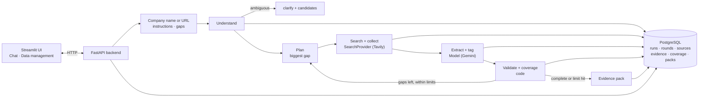

# VentureOS Research agent

> Version V.0.1 (`0.1.0`). Branch `agents/research`.

The Research agent is agent 1 of the VentureOS pipeline. Given a company name or website, it searches the web, keeps only relevant and verifiable evidence, tags it to the fields the GTM sub-agents need (company, market, competitors, sales), and stores every intermediate result in PostgreSQL. It gathers and organizes evidence; it does not analyze or write strategy.

## Input and output

**Input**

- A company name or website (required). `http://` is upgraded to `https://`, and the change is recorded.
- Optional instructions, for example `focus on mid-market` or `EU only`.
- Optional, on a re-run: a previous run ID and a list of gaps (for example `market.trends`), so only missing items are researched.

**Output: an evidence pack (schema v3)**

| Field | Checklist (checked in code) |
| --- | --- |
| Company | name, website, what they sell |
| Market | category, 1 or more size or growth signals, 2 or more trends |
| Competitors | 3 to 5 alternatives, each with website, positioning, and pricing (or `not_published`) |
| Sales | target customer, buyer role, pricing model, channel; buying signals optional |

- Every value is a list of evidence IDs. Each evidence item has a short statement, a verbatim excerpt, its source URL, the retrieval date, a `fact` or `inference` label, and 1 or more tags such as `competitors.pricing`.
- Coverage: for each field, `complete` or `partial`, with a list of what is missing.
- Run status: `complete`, `partial` (a limit was hit), `clarify` (the company name is ambiguous; candidates are returned), or `failed`.

The JSON Schema is in [src/research/pack.schema.json](src/research/pack.schema.json).

## Functionality

1. **Understand.** Normalize the website. With only a name, run 1 search and ask the model to confirm the official website; stop with `clarify` when it is ambiguous.
2. **Plan.** Code compares the pack with the checklist. Company basics go first; then fields rotate, so the field searched least goes next (ties go to the field with the most missing items).
3. **Search and collect.** Run 1 search from a fixed query template; open-web searches include the company domain to avoid same-name noise. If no page is kept, retry once with the field's next template in the same round. Skip duplicate and non-public or non-HTTPS URLs, remove cookie and navigation text, and reject pages about a different company. Caps: 3 general pages plus 2 pricing or customer pages from the company site, 2 pages per other site, 5 competitors.
4. **Extract and tag.** The model returns statements with verbatim excerpts and tags. Code checks every item; failed items get 1 corrective retry with the errors.
5. **Check coverage.** Code, not the model, recomputes coverage and stores a snapshot.
6. **Repeat** until every field is complete or a limit is hit: 5 rounds, 15 sources, 10 model calls. Hitting a limit returns a `partial` pack with its gap list, never an error.

Evidence rules enforced in code: excerpts are 25 to 400 characters and appear verbatim in their source; each excerpt supports 1 item; names and numbers in a statement must appear in its excerpt; facts from forums become inferences; company offering and pricing model must cite the company's own site when one was collected. Page text is treated as untrusted data.

## Mini-architecture



The loop is plain Python with fixed limits, not an agent framework. Search and model providers sit behind small interfaces, and storage sits behind a `Store` interface with PostgreSQL and in-memory implementations.

## Run

Requires Python 3.10+. Put `TAVILY_API_KEY`, `GEMINI_API_KEY`, and optionally `RESEARCH_DATABASE_URL` in `.env` (git-ignored). Without a database URL, runs are kept in memory until the backend stops.

```bash
python3 -m pip install -e '.[research,api,ui]'
```

Start the FastAPI backend, then the Streamlit UI in a second terminal:

```bash
PYTHONPATH=src python3 -m research.api
```

```bash
streamlit run UI/app.py
```

The UI only sends input and shows output; all processing runs in the backend. It has 2 views in the sidebar:

- **Chat:** send a company name or website. The agent asks a follow-up question when the name is ambiguous (reply with a number, name, or website) or when the pack is partial (reply `yes` to research only the missing items). Packs are shown with coverage, cited evidence, and a JSON download.
- **Data management:** every stored run, with its evidence pack, each round's query and coverage, and kept and rejected sources.

The backend binds to `127.0.0.1` and has no authentication, so run it on your own machine. Chat sessions are in memory; runs and packs are in the store.

| Endpoint | Purpose |
| --- | --- |
| `POST /api/sessions` | Start a chat session |
| `POST /api/sessions/{id}/messages` | Send `{"message", "instructions"}`; returns a job ID |
| `GET /api/jobs/{id}?after=N` | Progress events and the reply |
| `GET /api/runs` | Stored runs, newest first |
| `GET /api/runs/{id}` | 1 run and its evidence pack |
| `GET /api/runs/{id}/rounds` | Rounds, coverage per round, and sources |

A CLI is also available: `PYTHONPATH=src python3 -m research "Basecamp" --website basecamp.com`.

Tests use provider doubles and never call live services. Set `RESEARCH_TEST_DATABASE_URL` to a disposable database to run the PostgreSQL tests.

```bash
PYTHONPATH=src python3 -m unittest discover -s tests -v
```

## Status

- Implemented: input normalization, bounded loop, evidence checks, checklist coverage, re-runs from gaps, PostgreSQL and in-memory storage, FastAPI backend, Streamlit chat and data management UI, CLI.
- Planned: live smoke check, updated golden fixture, a model check that a statement follows from its excerpt, pgvector retrieval.
