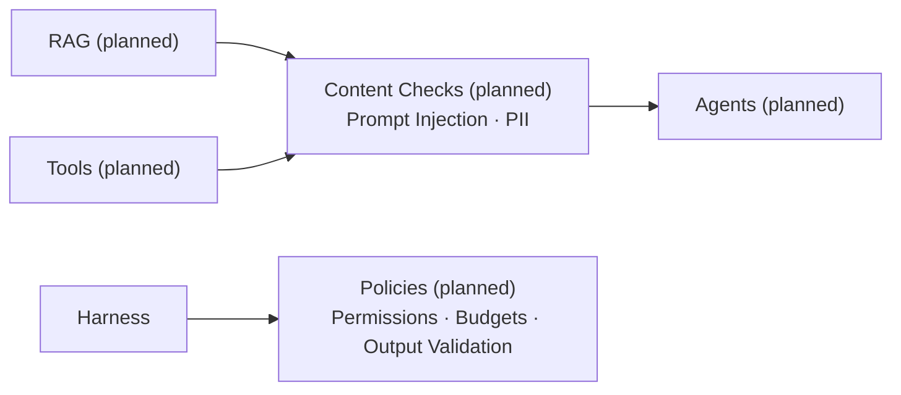

# Safety

The controls and execution paths below are (planned). The current harness only previews a workflow and rejects execution.

Content checks apply to retrieved material and tool outputs. They supplement scoped permissions, tenant isolation, and isolated execution; detection cannot guarantee prompt injection prevention. External content is evidence, not authority to change instructions.

HITL approval, action receipts, audit logging, and duplicate-action prevention are (planned). Offline regression and security evals are a CI release gate (planned), separate from runtime output validation.
