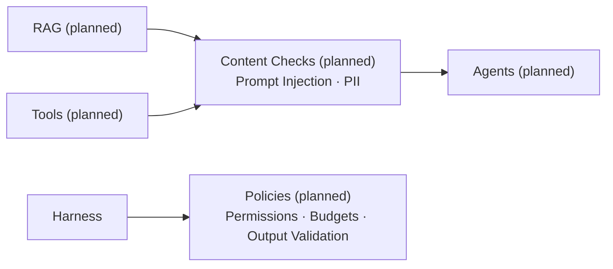

# Safety

The diagram shows target integration paths. RuntimeHarness implements task permissions, budget reservations, validation, and basic heuristic injection/PII checks. RAG and live tool adapters remain planned. The preview harness still rejects execution.

Content checks apply to retrieved material and tool outputs. They supplement scoped permissions, tenant isolation, and isolated execution; detection cannot guarantee prompt injection prevention. External content is evidence, not authority to change instructions.

Hash-bound task approval and payload-free audit records are implemented. External action receipts and duplicate-action reconciliation remain (planned); writes are disabled. Small offline content-policy regression fixtures run in the configured CI gate, separately from runtime output validation. Hosted CI execution is not yet verified.
