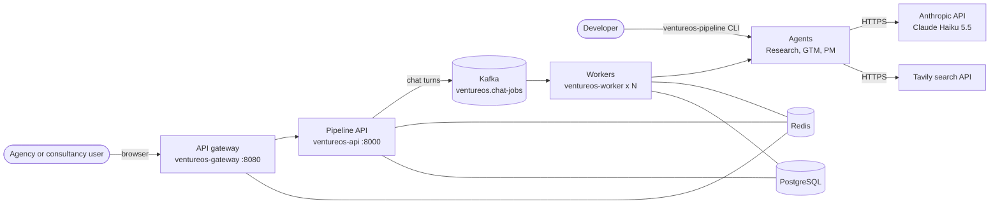
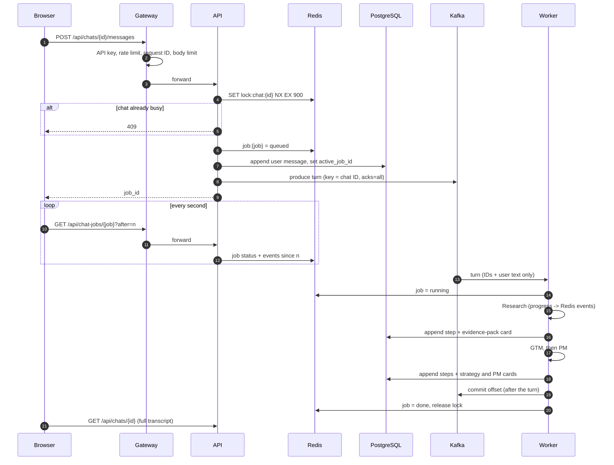
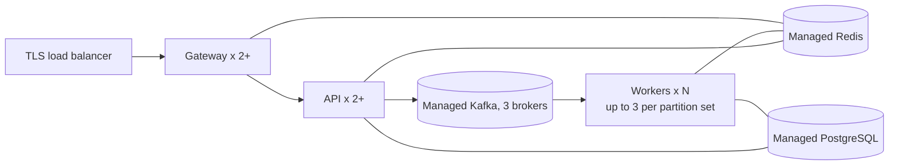

# VentureOS technical architecture

This page describes how VentureOS is built and run, and how ready each part is for production. It covers the code on `dev` plus the saved-chat infrastructure (pipeline V.0.4, gateway V.0.1). For the product view, see the [README](../../README.md); for a step-by-step run, see the [walkthrough](../walkthrough.md).

**Short answer on production readiness:** the agent pipeline and its guardrails are solid and well tested, and the infrastructure (PostgreSQL, Redis, Kafka, gateway) is built and verified on 1 machine. It is ready for a single-team, self-hosted deployment behind TLS. It is not yet ready for multi-tenant or internet-facing use: it has 1 shared API key instead of user accounts, no tracing or cost metering, and a few failure modes that need hardening. The [readiness scorecard](#7-production-readiness-scorecard) lists each gap.

## 1. System context

VentureOS proposes; a person decides. It sends nothing, builds nothing, and takes no action outside the system. The only outbound calls are to the model provider and the search provider.

## 2. Components

| Component | Code | Runs as | Responsibility |
| --- | --- | --- | --- |
| Research agent | `src/research/` | library | Bounded DeepAgents ReAct loop on Claude: search, read, and record evidence that quotes its source word for word. Output: evidence pack (schema v4). |
| GTM orchestrator | `src/gtm/` | library | 3 specialist sub-agents in parallel (market, competitive, challenger sales), a merge step, and a cited company snapshot. Output: strategy pack (schema v4). |
| PM agent | `src/pm/` | library | Baseline check in code, human check (HITL), then a use case, action plan, 1-pager, and MVP idea from a DeepAgents planner with code-validated tools. Output: PM result (schema v2). |
| Pipeline runner | `src/pipeline/runner.py`, `__main__.py` | CLI `ventureos-pipeline` | Runs the 3 agents in order for 1 company and writes JSON plus a Markdown report. |
| Chat service | `src/pipeline/chats.py` | library | 1 chat message = 1 turn: Research, then GTM on a new pack, then PM. Appends every step and result card to the chat's transcript. |
| Pipeline API | `src/pipeline/api.py` | `ventureos-api` (FastAPI, uvicorn) | Chat, Research, GTM, and PM endpoints; serves the built web UI at `/`. |
| Worker | `src/pipeline/worker.py` | `ventureos-worker` | Consumes chat turns from Kafka and runs them. Scales horizontally. |
| API gateway | `src/gateway/` | `ventureos-gateway` (FastAPI, httpx) | Front door: API key, rate limits, request IDs, body limit, upstream errors. Imports no agent code. |
| Web UI | `UI/` (React, TypeScript, Vite) | static files served by the API | Sends messages, follows job events, renders the stored transcript. No processing. |
| Report | `src/pipeline/report.py` | CLI `ventureos-report` | Formats results as Markdown and resolves every cited ID; adds no claims. |

**Dependency rule:** agent packages never import each other (1 read-only exception: `gtm` reads the evidence-pack contracts from `research`). Only `pipeline` imports all agents. The gateway imports nothing from either.

## 3. How a chat turn flows

A follow-up message in the same chat continues from the stored state: the open question (pick a website, or research the gaps) is saved with the chat, and the human-check answer (`POST /api/chats/{id}/decisions`) runs PM on the saved strategy pack.

## 4. Data

| Data | Where | Lifetime | Notes |
| --- | --- | --- | --- |
| Chats and transcripts | PostgreSQL `ventureos.sessions`, `ventureos.messages` | Permanent | Result cards keep their JSON in `payload` (JSONB), so a chat reopens fully. |
| Research runs | PostgreSQL `research.runs`, `rounds`, `sources`, `evidence_items`, `coverage_snapshots`, `packs` | Permanent | Full audit trail: every search round, kept and rejected URL (with reason), and evidence item. |
| GTM and PM results | JSON files `runs/gtm/<run id>.json`, `runs/pm/<run id>.json` | Permanent | Shared by the API and workers through a volume. File names are validated UUIDs. |
| Chat locks | Redis `lock:chat:{id}` | 15 minutes | Owner-checked release (Lua compare-and-delete). |
| Job status and progress | Redis `job:{id}`, `job:{id}:events` | 24 hours | Events capped at 200 per job. |
| Open-chat cache | Redis `chat:{id}` | 24 hours | Read-through and write-through; transcripts over 40 messages read from PostgreSQL. |
| Rate-limit counters | Redis `rl:*` | 1 window (60 seconds) | Fixed window per client IP. |
| Turn queue | Kafka `ventureos.chat-jobs` (3 partitions), `ventureos.chat-jobs.dlq` | Broker retention | Messages carry only IDs and the user's text. |

Schemas are versioned in code: evidence pack v4, strategy pack v4, PM result v2. GTM and PM check the schema version of their input and reject a mismatch.

## 5. Reliability and correctness by design

**Models propose; code decides.**
- **Evidence:** an excerpt is kept only if it is 25 to 400 characters and appears word for word in a page the search actually returned. URLs the search did not return, and evidence IDs not in the input, are rejected.
- **Labels:** a recommendation is `evidence_based` only when cited evidence states it directly; everything else is `hypothesis`.
- **Ranking:** competitive hypotheses are scored and ranked in code (4 sub-scores, 4 to 20).
- **Baseline:** PM checks coverage in code and stops for a person before planning on thin evidence.

**Bounded work.**
- **Research:** 12 search rounds, 36 sources, and 36 model calls.
- **GTM:** 3 sub-agents with 1 corrective retry each, plus a merge and a snapshot with up to 2 attempts.
- **PM:** a planner with a step limit, plus 1 JSON fallback call.
- **Limits:** hitting a limit returns a flagged `partial` result, never a crash.

**Failure handling.**

| Failure | Behavior |
| --- | --- |
| Invalid model output | 1 corrective retry with the validation error, then the item is dropped or the step is marked failed. |
| A GTM sub-agent fails | It is marked `failed`; the strategy pack is `partial`; PM's baseline catches it. |
| GTM or PM fails in a chat turn | The earlier cards stay; an error message is added; the job is `failed`; the lock is released. |
| Kafka unavailable when sending | HTTP 503; the lock and the chat's running job are cleared, so the user can retry. |
| A message that is not a valid turn | Sent to the dead-letter topic and committed; it never blocks the partition. |
| A turn fails in the worker | Recorded in the chat, then committed (no retry loop on bad input). |
| API down or slow | The gateway answers 502 or 504 with a clear message. |
| Redis down at the gateway | Rate limits fail open (requests pass, a warning is logged). |
| 2 messages at once in 1 chat | The second gets HTTP 409; 1 turn per chat at a time across all workers. |
| Restart of API or workers | Chats reload from PostgreSQL; a browser reattaches to a running turn by its job ID. |

**Delivery semantics:** Kafka delivery is at least once. The producer uses `acks=all` with idempotence; the consumer commits only after the turn finishes. See gap R3 for the consequence.

## 6. Security

| Area | Current state |
| --- | --- |
| Network exposure | The API and gateway bind to `127.0.0.1` by default. In Docker, only the gateway port is published, on `127.0.0.1:8080`. |
| Authentication | Optional single shared API key at the gateway (`X-API-Key`, constant-time compare). No user accounts. |
| Input limits | 64 KB body limit at the gateway; messages and instructions capped at 300 characters by the API; IDs validated as UUIDs. |
| Untrusted content | Web pages, evidence text, and model output are treated as data, never instructions. Only `https://` links are rendered, and React escapes all text (no `dangerouslySetInnerHTML`). |
| Secrets | API keys and database URLs come from the environment or a git-ignored `.env`. Logs never record keys, prompts, page text, or model output. The compose file's database password is for the local stack only. |
| Containers | The image runs as a non-root user. |
| Data sent out | Company names, search queries, and page excerpts go to Tavily and Anthropic. No user personal data is collected. |

## 7. Production-readiness scorecard

Status: **Ready** (works and is tested for this use), **Partial** (works, with known limits), **Gap** (missing).

| Area | Status | Evidence | What is missing |
| --- | --- | --- | --- |
| Correctness guardrails | Ready | Validation, citation checks, and ranking in code; offline tests for every rule | Automated quality evals on real output |
| Persistence | Ready | PostgreSQL for chats and Research runs; verified reopening after an API and worker restart with the Redis cache cleared | GTM and PM results are files (see S2) |
| Async processing | Ready | Kafka queue with manual commits, keyed ordering, a dead-letter topic; workers scale out | Duplicate handling on redelivery (R3) |
| Concurrency control | Ready | Redis lock per chat, owner-checked release | Stale-job cleanup after a worker crash (R2) |
| Graceful degradation | Ready | `partial` results, failure cards in the chat, 503 on queue outage, fail-open rate limits | |
| Configuration | Ready | Environment variables with in-memory fallbacks; `/api/health` names the backends in use | Startup check that fails fast when a configured service is down |
| Testing and CI | Ready | 172 tests; CI runs them with real PostgreSQL, Redis, and Kafka services | Load tests; a Docker image build in CI |
| Deployment | Partial | `Dockerfile` and `docker-compose.yml` for 1 machine | Not yet run end to end in Docker; no Kubernetes or cloud manifests; no TLS |
| Authentication and tenancy | Gap | 1 optional shared API key | User accounts, per-user chats, SSO, audit of who did what (S1) |
| Observability | Partial | Structured logs with durations; request IDs at the gateway; Research rounds stored with reasons; token counts logged for JSON calls | Request IDs in API and worker logs, tracing, metrics, alerting, dashboards (O1) |
| Cost control | Partial | Hard caps on searches and model calls per run; per-client rate limits | Token and cost metering per run and per user; budgets (O2) |
| Database operations | Partial | Idempotent migrations run at startup | Connection pooling, versioned migrations, backups (S3) |
| Data retention and privacy | Gap | | Delete a chat, retention policy, export (S4) |

### Known gaps and the fix for each

- **R1. No startup dependency check.** A worker or API starts even if Redis or Kafka is unreachable until the first call. Fix: ping every configured service at startup and in `/api/health`.
- **R2. A crashed worker leaves a turn "running".** The lock expires after 15 minutes, but the job stays `running` in Redis until it is redelivered or expires. Fix: a heartbeat on running jobs, and mark jobs without a heartbeat as failed.
- **R3. Redelivery can duplicate transcript messages.** A turn redelivered after a crash runs again from the start. Fix: make turns idempotent by job ID (skip steps already recorded for that job).
- **S1. Single shared API key.** Fix: user authentication (OIDC) at the gateway, a user ID on each chat, and per-user access checks.
- **S2. GTM and PM results on a shared file volume.** Fine on 1 host; on several hosts it needs shared storage. Fix: move them to PostgreSQL (the chat transcript already holds a copy).
- **S3. A new database connection per call.** Fix: `psycopg_pool`, plus versioned migrations and scheduled backups.
- **S4. No delete or retention.** Fix: a delete-chat endpoint with cascade, and a retention job.
- **O1. Tracing stops at the gateway.** Fix: pass `X-Request-ID` into API and worker logs and the Kafka message, and add OpenTelemetry traces for agent and tool calls.
- **O2. No cost metering.** Fix: count tokens from every call, including the DeepAgents loops, store them per run, and show them in the UI and report.
- **E1. No automated quality evals.** Fix: a fixed set of companies with code-scored checks and a scorecard per version.
- **D1. Docker stack not yet verified, and no TLS.** Fix: run `docker compose up` in CI as a smoke test, and put a TLS-terminating proxy or load balancer in front of the gateway.

## 8. Deployment

**Single machine (today):** `docker compose up --build` runs PostgreSQL 16, Redis 7, Kafka 3.9 (KRaft, 1 node), the API, 2 workers, and the gateway. Only the gateway is published, on `127.0.0.1:8080`.

**Scaled out (target):**

- **Stateless processes:** the gateway, API, and workers keep no local state for chats, so they scale horizontally. Rate limits and locks are shared through Redis. Exception: the older GTM and PM rerun endpoints of the Stored research view track their jobs in API memory; route them to 1 API instance or move them to the queue.
- **Throughput:** 1 worker runs 1 turn at a time (about 3 minutes). The topic has 3 partitions, so up to 3 workers in 1 group run in parallel; raise the partition count for more.
- **Rate limits:** the chat-turn limit (10 new messages a minute per client) and the run caps bound the model spend per client.

## 9. Configuration reference

| Variable | Used by | Default | Purpose |
| --- | --- | --- | --- |
| `ANTHROPIC_API_KEY`, `TAVILY_API_KEY` | API, workers, CLI | | Model and search providers |
| `RESEARCH_MODEL` | API, workers, CLI | `claude-haiku-5-5` | Model for every agent |
| `RESEARCH_DATABASE_URL` | API, workers | memory | PostgreSQL for chats and Research runs |
| `REDIS_URL` | API, workers, gateway | memory | Locks, jobs, chat cache, rate limits |
| `KAFKA_BOOTSTRAP_SERVERS` | API, workers | in-process queue | Turn queue; needs Redis and PostgreSQL |
| `KAFKA_TOPIC`, `KAFKA_GROUP` | API, workers | `ventureos.chat-jobs`, `ventureos-workers` | Topic and consumer group |
| `RESEARCH_API_HOST`, `RESEARCH_API_PORT` | API | `127.0.0.1`, `8000` | API bind address |
| `GATEWAY_UPSTREAM` | gateway | `http://127.0.0.1:8000` | Where the gateway forwards |
| `GATEWAY_API_KEY` | gateway | empty (no key) | Shared API key for `/api/*` |
| `GATEWAY_RATE_LIMIT`, `GATEWAY_MESSAGE_LIMIT` | gateway | `120`, `10` | Requests and new messages per client per minute |
| `GATEWAY_MAX_BODY` | gateway | `65536` | Body size limit in bytes |
| `GATEWAY_HOST`, `GATEWAY_PORT` | gateway | `127.0.0.1`, `8080` | Gateway bind address |
| `RESEARCH_LOG_LEVEL`, `RESEARCH_LOG_DIR` | API, workers | `INFO`, `logs` | Logging |

## 10. Testing and verification

- **Offline (every change):** 172 tests with provider doubles and fake Redis and Kafka clients. Run them with `PYTHONPATH=src python3 -m unittest discover -s tests -v`.
- **Integration (CI on every push):** the same tests also run against real PostgreSQL 16, Redis 7, and Kafka 3.9 through `RESEARCH_TEST_DATABASE_URL`, `REDIS_TEST_URL`, and `KAFKA_TEST_BOOTSTRAP`. Each integration test uses its own topic and keys.
- **Live checks (billed, by hand):** `scripts/live_smoke.py` for Research coverage, and full runs whose reports are in `examples/`.
- **Verified by hand on 19 November 2026** with PostgreSQL, Redis, and Kafka on 1 machine:
  - a full chat through the gateway (Linear: website question, pack, strategy, human check);
  - reattaching to a running turn after a page reload;
  - reopening the chat after restarting the API and worker with the Redis cache cleared;
  - answering the human check in that reopened chat;
  - the rate limit (429 with `Retry-After`) and request IDs in the gateway log.
- **Not yet verified:** the Docker compose stack (Docker was not running), load behavior, and multi-host deployment.
